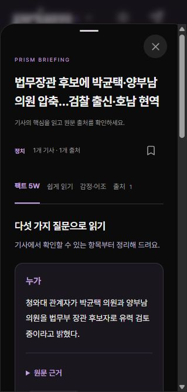
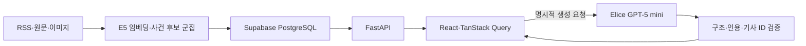

# PRISM

### 원문 근거와 출처를 확인하며 읽는 AI 뉴스 서비스

여러 언론사의 뉴스를 사건 후보별로 묶고, **팩트 5W·쉬운 설명·감정과 어조·뉴스 DM**으로 기사를 이해하는 모바일 우선 웹앱입니다. 분석 결과에서 원문 근거와 보도 출처로 이동하는 흐름을 구현했습니다.

**[공개 서비스 체험](https://prism-news-submission.vercel.app/)** · [최종 구현 코드 PR](https://github.com/chaechae001/Prism/pull/4) · [검증 실행 기록](https://github.com/chaechae001/Prism/actions/runs/40211823493)

> **개발 기간:** 2026.10.20–10.26, 7일 · **팀:** AI디어, 4명
> **정채은 담당:** 서비스 기획·화면·API 계약·AI 읽기/대화 통합·회귀 검증·공개 배포
> 설치·로그인 없이 공개 링크에서 체험할 수 있습니다. 현재 뉴스는 DB에 저장된 수집·군집 결과를 조회합니다.

## 화면으로 살펴보기

| 뉴스 피드 | 원문 근거를 확인하는 읽기 |
|:---:|:---:|
|  |  |
| 날짜별 스토리·기사 카드·출처·뉴스 DM 진입 | 유효한 5W 항목과 근거·출처 연결 |

2026.10.26 공개 서비스 실제 캡처입니다. 뉴스 제목·이미지의 권리는 각 보도 출처에 있으며, 화면은 검증 당시 상태입니다.

### 1분 체험

1. **[서비스 접속](https://prism-news-submission.vercel.app/)** → 뉴스 카드 선택
2. **팩트 5W** → 읽기 시작 → 확인된 항목과 원문 근거 확인
3. **쉽게 읽기** → 설명을 읽고 마지막 하단의 공통 근거·출처 확인
4. **감정·어조 / 출처** → 기사별 표현과 원문 살펴보기
5. **뉴스 DM** → 선택 기사에 관한 질문 → 기사 근거가 연결된 답변 확인

## 왜 만들었나요?

같은 사건도 매체마다 강조점이 다르고, AI 요약만 읽으면 근거가 된 문장을 다시 찾기 어렵습니다. PRISM에서는 **탐색 → 이해 → 근거 확인 → 질문**을 하나의 흐름으로 연결했습니다.

필터 버블 해소나 AI 사실성의 개선 효과를 측정한 서비스는 아닙니다. 이번 프로젝트에서는 실제 뉴스 조회, 기사 범위에 묶인 AI 응답, 출처 연결과 실패 상황의 사용자 경험을 구현·검증했습니다.

## 주요 기능과 현재 범위

| 기능 | 구현 내용 |
|---|---|
| 뉴스 탐색 | 날짜별 스토리, 정치·경제·사회·기술 필터, 검색·사진 탐색, 커서 기반 무한 스크롤 |
| 팩트 5W | 항목명·형식·기사 소속·정확한 인용을 개별 검증하고, 유효한 항목만 표시 |
| 쉽게 읽기 | 쉬운 설명 카드 뒤에 근거 토글 1개·출처 버튼 1개 배치, 중복 인용 정리 |
| 감정·어조 | 기사별 매체·제목·전체 어조·짧은 이유와 원문 근거 제공 |
| 뉴스 DM | 선택 뉴스의 허용 본문을 기반으로 질의응답, 반환 기사 ID 검증 |
| 개인 기록 | 북마크·개인 댓글·DM 기록과 삭제, 현재 비회원 브라우저별 저장 |
| 요약 운영 | 초안 생성·입력 버전 검사·사람 검토 후 게시 코드. 운영 API는 외부 접근 차단 |
| 모바일·테마 | 다크 기본·라이트 전환, 공통 카드 스타일·최소 44px 버튼·줄바꿈 |

**후속 개발:** 관점 비교는 다중 기사·본문 조건 검증을 위해 UI를 숨겼고 API 호환 기반은 유지합니다. 계정 간 동기화·음성은 현재 제공 기능에서 제외했습니다. 수집 스케줄러와 임베딩 모델이 공개 API 요청마다 실행되지는 않습니다.

## 나의 기여와 팀 협업

| 팀원 | 담당 |
|---|---|
| **정채은** | 기능 기획·사용자 흐름, React 화면 전반, OpenAPI 계약·타입, 팀 API/군집 데이터 통합, AI 읽기·뉴스 DM, 요약 검토·평가 기능, CI·최종 검증·Vercel 배포 |
| 최민준 | 초기 FastAPI·DB 조회·RSS 파싱/적재·Elice 단일 기사 요약 |
| 신재원 | 원문·이미지 수집, E5 사건 군집, 군집 저장·수집 실행 관리 |
| 선건후 | 데이터 분석·수집 데이터 및 군집 결과 검토 보조 |

팀의 수집·분석 결과를 사용자가 탐색하고 근거를 확인할 수 있는 서비스로 연결하는 역할을 맡았습니다. 개인 레포의 최종 동기화 커밋은 팀 코드를 통합한 결과이며, 팀 전체 코드를 혼자 처음부터 작성했다는 의미는 아닙니다.

## 기술 구조



| 영역 | 사용 기술·역할 |
|---|---|
| Frontend | React, TypeScript, Vite, TanStack Query, Radix UI, Lucide |
| Backend | Python 3.13, FastAPI, Pydantic, HTTPX, SQLAlchemy, psycopg |
| Database | Supabase PostgreSQL, 배치·기사·군집 복합 키, 본문/입력 해시, 검토 상태 |
| Data pipeline | 언론사별 수집 어댑터, E5-small ONNX int8, K-means 후보와 추가 사건 단서 검증 |
| AI | Elice GPT-5 mini, 구조화 응답, 허용 본문·기사 ID·인용 검사 |
| Deployment | Vercel 화면/Python API, 트랜잭션 풀러, 서버 환경변수 |
| Verification | OpenAPI 타입 생성, unittest·pytest, Vitest·MSW, GitHub Actions |

RAG·LangChain·LangGraph·Opik·Ollama/BGE는 **설정으로 활성화하는 선택형 확장**입니다. 기본 공개 경로 전체가 이 도구를 항상 사용하는 것은 아닙니다. Fine-tuning은 학습 데이터 준비 기반이며 실제 모델 학습 성과로 소개하지 않습니다.

### 주요 설계 결정

- **조회와 생성 분리:** GET은 결과 조회, POST는 이용자가 요청한 AI 생성. 화면을 여는 것만으로 모델을 호출하지 않습니다.
- **계약 유지:** 뉴스 v1/social API와 생성 TypeScript 타입을 함께 관리합니다.
- **근거와 버전 추적:** 허용 본문·기사 소속·해시를 확인하고 생성 결과를 입력 버전에 연결합니다.
- **공개·운영 분리:** 비밀값은 서버 환경변수에 보관하고 운영자 경로는 외부에서 차단합니다.

## 문제 해결 사례

### 1. 잘못된 5W 한 항목 때문에 전체 결과를 잃지 않도록

**문제:** 모델 응답의 일부 항목명이나 인용이 잘못되면 다른 유효한 정보도 사용하지 못할 수 있었습니다.

**해결:** 항목별로 구조·이름·기사 소속·인용을 검사하고 잘못된 항목만 제외했습니다. 중복은 정리하고 누가·언제·어디서·무엇·왜 순서로 표시합니다. 일부만 있으면 확인된 개수를 알리고 0개이면 원문 확인·재분석을 안내합니다. 응답 계약을 유지하면서 캐시 버전을 갱신했습니다.

**검증:** 유효/무효 혼합·인용 오류·부분/빈 결과 회귀 검사. 정확한 인용 검사는 생성 문장 전체의 의미적 사실성을 보장하지 않습니다.

[서버 구현](backend/app/services/reading_modes.py) · [서버 테스트](backend/tests/test_reading_modes.py) · [UI 테스트](frontend/src/components/AnalysisPanel.test.tsx)

### 2. 상세를 다시 열면 방금 생성한 분석이 사라지는 문제

**원인:** 서버리스의 휘발성 캐시가 비어 있는 GET 응답이 브라우저의 생성 결과를 덮을 수 있었습니다.

**해결:** 생성 성공 시 setQueryData로 조회 캐시를 갱신했습니다. 기사 ID·updated_at·모드·프롬프트 버전으로 키를 나누고 같은 버전에는 staleTime: Infinity를 적용했습니다.

**검증:** QueryObserver 회귀 검사 2개와 공개 링크에서 생성 후 146초 뒤 재열기 시 5W 카드 5개 유지 확인. 새로고침 이후까지 보존하는 영구 저장은 아닙니다.

[상태 구현](frontend/src/hooks/useReadingAnalysis.ts) · [회귀 검사](frontend/src/hooks/useReadingAnalysis.test.ts)

### 3. 로컬 PC에 의존하던 실행을 공개 링크로 연결

**해결:** Vercel에서 React·Python API를 같은 주소로 제공했습니다. 서버리스에서는 Supabase 트랜잭션 풀러·SQLAlchemy NullPool·prepare_threshold=None을 사용하고 TLS와 로컬 기본 풀 설정을 유지했습니다.

**검증:** 공개 링크의 실제 AI 생성·뉴스 대화를 포함한 API 검사 14개 통과. 소규모 DB 동시 읽기 6건 모두 성공했으며 운영 부하 벤치마크로 해석하지 않습니다.

[DB 연결](backend/app/db.py) · [배포 진입점](api/index.py) · [Vercel 설정](vercel.json)

## 검증 결과

2026.10.26 최종 구현 검증 기록입니다. 아래 환경의 수치는 서로 합산하지 않습니다.

| 검증 환경 | 결과 |
|---|---|
| 개인 코드 체크아웃 + 독립 PostgreSQL | **442 passed / 6 skipped / 285 subtests passed** |
| Frontend | **17개 파일·90개 테스트 통과**, 타입 검사·프로덕션 빌드 통과 |
| 배포 소스의 백엔드·분석 | 411 passed / 37 skipped / 289 subtests passed, 당시 DB 미설정 |
| 최종 코드 15705e5 GitHub Actions | backend·clustering·frontend·ai-extensions **4개 성공** |
| 공개 서비스 | 실제 AI 생성·대화 포함 **14개 API 검사 통과** |
| 모바일·상태 | 319px에서 가로 넘침 없음, 다크/라이트·출처 이동, 146초 후 재열기 결과 유지 |

skip은 통과에 포함하지 않았습니다. 테스트 개수는 AI 정확도·사용자 만족도·필터 버블 감소 효과를 뜻하지 않습니다. [최종 코드 및 검증 근거](https://github.com/chaechae001/Prism/pull/4)

## 로컬 실행

검증 환경은 **Python 3.13·Node.js 24**, 명령 예시는 PowerShell입니다.

### 1. 키 없이 UI 확인: 모의 뉴스

```powershell
cd frontend
npm.cmd ci
npm.cmd run dev -- --port 5183
```

[http://127.0.0.1:5183](http://127.0.0.1:5183)에서 MSW 모의 피드를 확인합니다. 공개 배포의 DB·AI 동작과는 별도 실행 모드입니다. 실제 AI 요청에는 백엔드와 제공자 설정이 필요합니다.

### 2. DB 뉴스·본문·AI 연결

서버 의존성을 설치하고 .env.example과 backend/.env.chat.example의 항목을 **로컬 전용 환경 파일**에 설정합니다. 기존 파일을 덮어쓰지 않습니다. DB 스키마와 군집 데이터가 준비되어 있어야 합니다.

```powershell
python -m pip install -r backend/requirements.txt
powershell -ExecutionPolicy Bypass -File scripts/run-connected-news.ps1
```

다른 터미널:

```powershell
cd frontend
npm.cmd ci
$env:VITE_API_BASE_URL='http://127.0.0.1:8006'
npm.cmd run dev:http -- --port 5186
```

기본 연결 스크립트는 계정·RAG 확장을 활성화하지 않습니다. DB를 초기화하거나 자동 수집하지 않으며 기존 namespace의 데이터를 조회합니다. 서버 키·DB 비밀번호를 VITE_ 변수나 Git에 넣지 않습니다.

[DB 연결 안내](docs/DATABASE.md) · [AI 연결 안내](docs/AI_CHAT.md) · [API 계약](contracts/openapi.json) · [추가 계약](contracts/workspace-openapi.json)

### 테스트·빌드

```powershell
python -m unittest backend.tests.test_local_reading backend.tests.test_reading_modes -q
python -m pytest analysis/tests backend/tests -q
cd frontend
npm.cmd test
npm.cmd run build
```

전체 Python 검사에는 requirements-clustering-dev.txt·requirements-llm-dev.txt의 추가 의존성과 별도 테스트 DB가 필요합니다. DB 통합 검사는 운영 DB를 사용하지 않으며, 정확한 설치·검사 조합은 [.github/workflows/checks.yml](.github/workflows/checks.yml)을 따릅니다.

## 코드 지도

```text
frontend/src/
  components/             피드·상세·읽기 카드
  features/               뉴스 DM·개인 기록·운영 화면
  hooks/                  조회·생성·브라우저 캐시
  api/                    HTTP 클라이언트·생성 타입
backend/app/
  services/               본문·읽기·요약·품질 검증
  chat/                   뉴스 대화·제공자
  cluster_store/          배치·기사·군집 저장
  scheduled_news/         수집 실행 관리
  ai_pipeline/            선택형 검색·그래프·관측 확장
analysis/                 수집·E5 사건 군집
contracts/                OpenAPI·JSON Schema
database/migrations/      SQL 마이그레이션
api/                      Vercel 진입점
```

## 다음 개발

다매체 동일 사건 평가셋, 5W 설명의 의미 적합성 평가, 공유 영구 캐시·분산 사용량/비용 제한, 클라우드 수집 운영을 우선 검토합니다. 관점 비교와 계정 동기화는 별도 검증 후 공개할 계획입니다.
