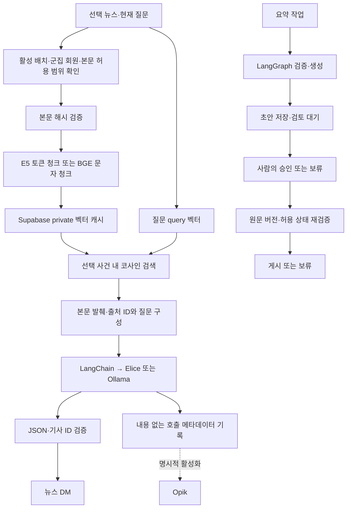

# AI 검색·모델·검토·운영 파이프라인

기존 뉴스 UI와 `/api/v1` 계약을 유지하면서 선택적 AI 모듈을 추가했습니다. 기본 제공자는 Elice이며 계정 기능은 테스트 모드에서 비활성 상태입니다.

## 구현·검증 상태

| 항목 | 구현 | 검증 범위 |
|---|---|---|
| Ollama | 루프백 전용 JSON Schema 어댑터, 준비 상태 조회, 모델 선택 설정 | 모의 HTTP 응답·키 비전송·외부 호스트 거절. Gemma 실호출은 현재 PC에서 시간 초과. 어댑터 자동 테스트 통과, 운영 제공자는 Elice 유지 |
| Hugging Face E5 | 기존 군집 인코더와 별도로 query/passage 검색용 ONNX 인코더 | 토큰 창·벡터 저장 코드와 고정 테스트 벡터 검증. 실제 E5 파일은 별도 준비 |
| RAG | 허용 본문 청크, 모델·본문 버전 캐시, 선택 사건 내 코사인 검색 | 독립 PostgreSQL에서 캐시 재사용·사건 분리 검증. 실제 APEC 기사 544자 청크 검색 약 17초, Elice 출처 답변 HTTP 200. 대규모 성능은 미검증 |
| LangChain | 선택 뉴스 검색 Runnable, 기존 제공자 호출, Pydantic 출력 파서 | 자동 테스트 및 실제 Elice 뉴스 답변 검증 |
| LangGraph | 검증→생성→검토 중단→승인/보류, SQLite 체크포인트·실패 재시도 | 재시작 복원 자동 테스트와 실제 초안의 검토 대기 저장·재조회 |
| Fine-tuning | 사람 검토·학습 허용 확인, 사건별 train/validation/test 분리, 평가 CLI | 가상 예제 분할 검증. 학습 실행·모델 가중치 변경 없음 |
| LLMOps | 호출 지연·버전·오류·토큰·선택적 추정 비용 저장 | 실제 모델 호출 기록. 미설정 비용은 null |
| Opik | 허용된 메타데이터만 수동 SDK 추적, 기본 비활성 | 비식별 전송 형식·비활성 상태 미전송 테스트. 실제 서버 연동은 별도 설정 |

## 흐름



## 설치와 스키마

```powershell
.venv/Scripts/python -m pip install -r requirements-llm.txt
.venv/Scripts/python scripts/ai_pipeline.py schema
.venv/Scripts/python scripts/ai_pipeline.py schema --apply
```

스키마 적용은 명시적 명령에서만 수행합니다. `private.prism_rag_chunks`, `private.prism_llm_runs`에 RLS를 활성화하고 브라우저 역할의 직접 접근을 차단합니다. 기존 기사·군집·계정 테이블을 초기화하지 않습니다.

청크 벡터는 PostgreSQL `real[]` 배열(E5 384차원, BGE-M3 1024차원)에 저장하고, 선택 사건 범위 내에서 NumPy의 정규화 벡터 내적으로 정확 코사인 검색합니다. 현재 규모에 맞춘 구현이며 **pgvector/HNSW를 설치한 구성은 아닙니다.** 전체 기사 대규모 검색이 필요해지면 범위·품질 평가 후 pgvector 인덱스로 전환할 수 있습니다.

## 실행 모드

LangChain과 운영 기록을 켭니다. Elice 설정은 기존 비공개 서버 환경 파일을 사용합니다.

```powershell
./scripts/run-connected-news.ps1 -Python .venv/Scripts/python.exe -EnableAIExtensions
```

E5 모델을 준비한 뒤 RAG를 추가로 켭니다.

```powershell
$env:PRISM_E5_MODEL_DIR='C:/absolute/path/to/multilingual-e5-small'
./scripts/run-connected-news.ps1 -Python .venv/Scripts/python.exe -EnableAIExtensions -EnableRag
```

필요 파일은 `tokenizer.json`, `onnx/model_quantized.onnx`입니다. 런타임은 자동 다운로드하지 않습니다. 기본 Git 제외 위치는 `.models/multilingual-e5-small`입니다. `query: `와 `passage: ` 접두사를 구분하고 320토큰 청크·48토큰 겹침을 사용합니다. 모델 파일 해시가 달라지면 기존 벡터를 재사용하지 않습니다.

설치된 Ollama BGE-M3가 있다면 E5 파일 다운로드 없이 검색할 수도 있습니다. 검색 모델과 답변 모델은 독립적으로 선택합니다. 아래 모드는 답변 제공자를 기존 Elice로 유지합니다.

```powershell
$env:PRISM_EMBEDDING_PROVIDER='ollama'
$env:OLLAMA_EMBED_MODEL='bge-m3:latest'
./scripts/run-connected-news.ps1 -Python .venv/Scripts/python.exe -EnableAIExtensions -EnableRag
```

BGE-M3는 600문자 청크·80문자 겹침을 사용하며 자동 잘라내기를 끕니다. 설치 모델 digest와 청크 설정을 캐시 키에 포함합니다. 군집 분석에 사용하는 E5와 뉴스 DM 검색에 사용하는 BGE는 역할이 다릅니다. 서로 성능이 같다고 간주하지 않습니다.

Ollama는 별도로 설치하고 사용할 모델을 준비한 경우에만 답변 제공자로 선택합니다.

```powershell
$env:PRISM_CHAT_PROVIDER='ollama'
$env:OLLAMA_MODEL='<로컬에 준비한 모델명>'
./scripts/run-connected-news.ps1 -Python .venv/Scripts/python.exe -EnableAIExtensions
```

Ollama 주소는 루프백 HTTP만 허용하며 Elice/OpenAI 키를 보내지 않습니다. 이 어댑터는 모델 다운로드·pull을 실행하지 않습니다. 모델별 한국어·구조화 응답 품질은 동일한 평가 자료로 확인해야 합니다.

## 화면에서 검증

연결 및 피드 설정의 **AI 연결·검색·운영**을 엽니다.

1. 현재 제공자·모델, 선택 검색 모델, 검색 DB, LangChain·Ollama 준비 상태를 확인합니다.
2. 검색 모델 준비 후 뉴스를 선택하고 검색 질문을 입력합니다. **LLM 호출 없이 검색 점검**으로 선택 사건의 청크만 조회하는지 확인합니다.
3. 검토 작업 시작은 모델 호출 또는 기존 초안 재사용 후 승인 대기에서 멈춥니다.
4. 요약 검토 도구에서 초안과 출처를 확인한 뒤 승인·게시 또는 보류를 선택합니다.
5. 실패 단계 재시도는 명시적 버튼으로 실행합니다. 유료 생성 단계는 자동 반복하지 않습니다. 연결 오류에 대한 안전한 읽기 검증만 제한적으로 자동 재시도합니다.
6. 작업 ID는 로컬 브라우저에 보관되며 기존 작업 불러오기로 체크포인트를 조회할 수 있습니다.
7. 최근 24시간 호출·오류·평균 지연·토큰·비용 상태를 확인합니다.

체크포인트는 `data/private/ai/workflows.sqlite`에 ID·단계·판정만 저장합니다. 원문이나 대화 전문은 넣지 않습니다. SQLite 워크플로는 로컬 단일 서버용입니다. 다중 서버 배포 전에는 PostgreSQL 등 공유 체크포인트와 관리자 인증이 필요합니다.

## 운영 기록과 Opik

운영 기록은 모델·프롬프트·입력 해시·처리 시간·토큰·오류 종류만 저장합니다. 질문·답변·기사 본문·사용자 ID를 기록하지 않습니다. 비용은 실제 청구액이 아닌 설정 단가에 따른 추정치입니다. 아래 단가가 없거나 제공자가 토큰을 주지 않으면 null입니다. Ollama의 하드웨어·전력 비용도 0으로 간주하지 않습니다.

```text
PRISM_INPUT_USD_PER_MILLION=
PRISM_OUTPUT_USD_PER_MILLION=
```

Opik은 기본 비활성입니다. 개인 질문·원문을 전송하는 자동 추적 데코레이터를 사용하지 않습니다. LangSmith의 환경 기반 자동 추적도 체인·그래프에서 비활성화합니다.

자체 Opik 서버 또는 공식 클라우드를 명시적으로 설정할 때만 다음 서버 환경변수를 사용합니다. 키는 서버의 비공개 환경 파일에 저장합니다.

```text
PRISM_OPIK_ENABLED=1
OPIK_URL_OVERRIDE=http://127.0.0.1:5174/api
OPIK_PROJECT_NAME=prism
OPIK_WORKSPACE=default
OPIK_API_KEY=
```

공식 클라우드 주소는 `https://www.comet.com/opik/api`입니다. 주소·키가 준비되지 않은 상태로 활성화하지 않습니다. SDK의 별도 오류 보고와 사용 분석은 끄고 허용된 운영 메타데이터만 명시적으로 보냅니다.

## Fine-tuning 자료 준비와 평가

형식은 `contracts/reviewed-training.schema.json`, 가상 예제는 `contracts/reviewed-training.examples.json`입니다. 모든 사례는 `human_reviewed=true`, `approved_for_training=true`가 필요합니다. 동일 사건 그룹은 한 분할에만 들어갑니다. 실제 DM 기록을 자동 학습 자료로 사용하지 않습니다.

```powershell
.venv/Scripts/python scripts/ai_pipeline.py prepare-training --input <검토된사례.json> --output data/private/ai/training-splits
.venv/Scripts/python scripts/ai_pipeline.py evaluate --input <회귀평가사례.json>
```

출력은 비공개 폴더에 train/validation/test JSONL과 manifest입니다. 기존 파일을 덮어쓰지 않습니다. 이 명령은 외부 학습 서비스 호출이나 가중치 학습을 하지 않습니다. 실제 학습은 데이터량·허용 근거·목표 모델·하드웨어·독립 평가셋을 정한 뒤 진행해야 합니다.

회귀 평가는 허용된 기사 ID, 정답에 포함돼야 할 문자열, 포함되면 안 될 문자열을 확인하는 보조 검사입니다. 전체 사실성·정치적 객관성의 정확도로 발표하지 않습니다.

## 관련 코드

`backend/app/ai_pipeline/`에 제공자·임베딩·검색·체인·워크플로·관측·평가를 분리했습니다. 실제 모델·워크플로 상태·학습 자료·비밀 환경변수는 Git에 포함하지 않습니다.

## 상세 읽기 모드

팩트 5W·쉬운 설명·어조·기사별 강조점은 `services/reading_modes.py`와 로컬 전용 `reading_api.py`에 분리했습니다. GET은 저장된 결과만 읽고 POST로 생성합니다. 원문 구간 ID 선택과 실제 인용 일치를 검증하고 비공개 로컬 캐시에 버전별 저장합니다. 다중 서버 배포 전 공유 캐시와 관리자 인증이 필요합니다.
