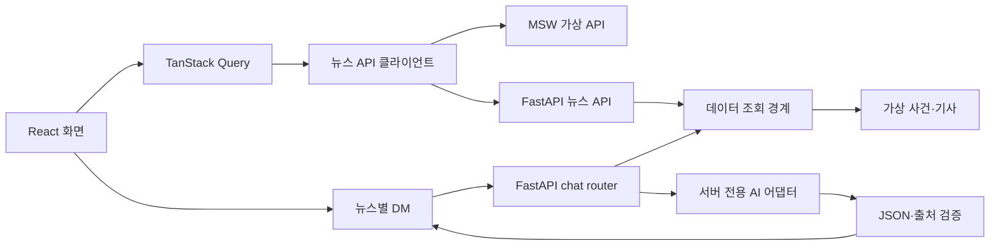

# 아키텍처

## 요청 흐름

## 데이터와 상태

`contracts/openapi.json`과 `backend/app/models.py`가 뉴스 API 형식의 기준입니다. 생성된 프론트 타입은 `frontend/src/api/schema.d.ts`이며 공유 응답 필드를 화면 편의로 임의 변경하지 않습니다.

TanStack Query는 목록 페이지와 상세 조회를 관리합니다. `useNewsWorkspace`는 탐색 조건과 북마크를, `useSocialWorkspace`는 댓글과 뉴스별 대화를 관리합니다. localStorage는 브라우저 단위 저장이며 계정 동기화를 제공하지 않습니다.

`connection_repository.py`는 데이터 소스를 화면용 Story로 변환합니다. 기본 `fixture`는 가상 데이터를 반환합니다. `rss-fixture`는 포함된 공통 RSS 예시를 검증합니다. `db-demo`와 `rss-reader`는 별도 DB reader 모듈을 요구하는 확장 지점으로 현재 저장소만으로 사용할 수 없습니다. 연결 실패를 가상 데이터로 자동 대체하지 않습니다.

`rss_preview.py`는 발행일·공개 조건을 확인하고 RSS 설명을 AI 요약으로 표시하지 않습니다. `database/schema.draft.sql`은 설계 참고용 초안이며 자동 설치 migration이 아닙니다.

## 뉴스 AI 대화

1. 프론트는 사건 ID와 질문·제한된 대화 기록만 전송합니다.
2. 서버가 사건을 조회해 제목·제공된 요약·관련 기사 정보를 구성합니다.
3. 제공자 어댑터가 서버 전용 키로 모델을 호출합니다.
4. 응답 JSON과 기사 ID를 검증한 뒤 답변을 반환합니다.

기사·대화 기록은 참고 자료로 처리하며 시스템 지시로 사용하지 않습니다. 현재 본문 전문은 포함되지 않습니다. API 키는 프론트 환경 변수나 공개 응답에 전달하지 않습니다.

## 모듈 경계

| 영역 | 주요 위치 |
|---|---|
| 화면과 상호작용 | frontend/src/components, features |
| 서버 상태·브라우저 상태 | frontend/src/hooks |
| HTTP·타입·Mock | frontend/src/api, mocks |
| 뉴스 조회 API | backend/app/connection_api.py |
| 데이터 소스 변환 | backend/app/connection_repository.py, rss_preview.py |
| 뉴스 대화 | backend/app/chat |
| 계약·fixture | contracts |

기본 실행은 `app.api:app`입니다. `social_api.py`는 기존 명령 호환용, `main.py`는 독립 가상 API 진입점입니다. 새 기능은 기본 진입점의 router 또는 데이터 조회 경계를 통해 연결합니다.
