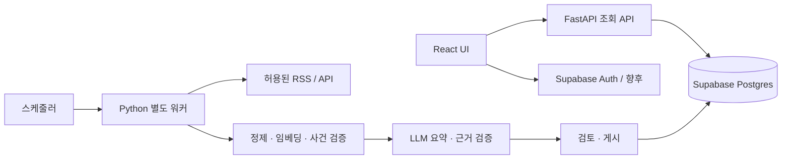

# 데이터가 준비되기 전, 개발자는 무엇을 해야 할까?

기준일: 2026-10-21. 3인 팀(개발자 2명·분석가 1명)을 위한 제안입니다. 일정은 각자 하루 단위로 투입할 수 있다는 가정의 **예시**이며 확정 일정이 아닙니다.

## 1. 먼저 서비스의 목표를 한 단계 보완하세요

현재 기획은 ‘뉴스 수집 → 중복 제거 → 동일 사건 묶기 → 요약’에 잘 맞습니다. 다만 **중복이 적은 뉴스 서비스**와 **필터 버블을 줄이는 서비스**의 목표는 다릅니다. 사건을 잘 묶어도 사용자가 관심 있는 사건만 계속 보게 되면 주제 편중은 남습니다. 여러 언론사를 모아도 같은 통신사 기사를 재전송한 것이라면 독립적인 관점이 늘었다고 보기 어렵습니다.

MVP에는 다음 세 가지를 더하는 것을 권합니다.

| 추가 기능 | 사용자가 얻는 것 | 첫 구현 |
|---|---|---|
| 같은 사건의 쟁점·관점 비교 | 무엇을 다르게 강조하는지 이해 | ‘기회·현장 과제·제도’처럼 근거가 있는 쟁점별 설명 |
| 추천 이유 + 탐색 폭 조절 | 왜 노출됐는지 이해하고 직접 조정 | 주제·출처 반복에 감점을 주는 규칙 기반 재정렬 |
| 주제 밖 탐색 경로 | 평소 보지 않던 사건을 만날 기회 | 개인화 없는 ‘발견 모드’, 카테고리 분포 표시 |

초기에는 정치 성향을 추론하거나 사용자에게 ‘편향 점수’를 붙이지 않는 편이 좋습니다. 쟁점별 관점은 기사 단위로 설명하고 근거를 연결하세요. 사실에 대한 검증 수준이 다른 주장을 단순히 50:50으로 배치하는 것은 목표가 아닙니다. 출처 부족·근거 불일치·불확실성도 그대로 보여주세요.

이번 UI의 다양성 숫자는 **현재 불러온 목록에서 주제와 언론사가 얼마나 섞였는지**입니다. 인지적 필터 버블 감소나 정치적 중립성을 증명하지 않습니다. 개인 이력을 수집하지 않으므로 ‘이 사용자가 놓친 뉴스’라고 단정하지 않습니다.

## 2. 데이터가 없어도 개발할 수 있는 이유

프론트엔드는 군집 알고리즘 자체를 실행하는 것이 아니라 결과 JSON을 보여줍니다. 분석가가 모델을 완성할 때까지 기다릴 필요가 없습니다. 팀이 JSON의 구조를 먼저 합의하면 개발자는 가상 결과를 넣어 화면·API·오류 처리를 만들고, 분석가는 그 형식에 맞는 실제 결과를 준비할 수 있습니다.

이번 스타터에는 그 연결 고리를 구현했습니다.

```text
Pydantic 모델(계약의 원본)
  ├─ OpenAPI JSON → 자동 생성 TypeScript 타입
  ├─ FastAPI Mock → HTTP로 확인
  └─ fixture JSON → MSW → fetch → TanStack Query → React UI

나중에 교체할 부분:
  FixtureRepository → SupabaseRepository
  Mock 작업 상태 → 별도 워커의 실제 작업 상태
  가상 요약 → 검증·승인된 실제 요약
```

비유하면 ‘콘센트 규격’을 먼저 정하는 것입니다. 실제 데이터가 아직 오지 않아도 개발자는 규격에 맞는 기기를 만들 수 있습니다. 데이터에 맞춰 화면 구조를 계속 바꾸지 않도록 필드 이름·상태·null 규칙부터 고정하세요.

## 3. 역할은 화면별보다 시스템 경계별로 나누세요

본인이 백엔드/AI에 집중하려는 의도를 반영한 분담입니다. 다른 개발자가 프론트엔드 통합·검증을 맡는다는 가정이며 팀 숙련도에 따라 조정할 수 있습니다.

| 담당 | 주 책임 | 데이터 준비 중 할 일 | 완료 증거 |
|---|---|---|---|
| 본인: 백엔드·AI 통합, UX 결정 | API, 저장 구조, 워커, 요약 검증, 최종 사용자 흐름 | 계약 정의, Mock 서버, Repository 경계, 작업 상태, 인증 설계, LLM 출력 스키마 | Swagger·테스트·샘플 JSON·실행 명령 |
| 개발자 2: 프론트엔드 통합·배포 | AI가 만든 UI 검수, 상태 관리, 반응형, 사용자 테스트 | MSW 연결, 검색/필터 URL, 상세·출처 탭, 로딩/오류, 북마크 | 실제 브라우저에서 성공·실패 흐름 재현 |
| 분석가: 데이터·군집·평가 | 수집 가능한 소스, 정제, 동일 사건 판단, 임베딩·군집 비교 | 전달 샘플, 정답 쌍, 출처 독립성 기준, 오분류 사례 정리 | 버전 있는 데이터·라벨 기준·평가 결과 |

본인이 디자인까지 맡더라도 Figma 전 화면을 완성한 뒤 개발을 시작할 필요는 없습니다. **사용자 흐름 1장 + 디자인 토큰 + 카드·상세 컴포넌트**를 먼저 확정하고, AI에 화면 구현을 맡긴 뒤 본인이 정보 구조와 근거 표현을 검수하세요. AI가 생성한 프론트엔드에도 사람이 책임지는 통합 담당이 필요합니다.

매일 15분 동안 ‘어제 변경한 계약, 오늘 필요한 샘플, 막힌 작업’만 공유하고, 나머지는 문서·PR로 남기세요. 서로의 소스 파일을 동시에 수정하기보다 담당 경계를 유지하는 편이 충돌을 줄입니다.

## 4. 처음 10일의 실행 계획

| 시점 | 본인(백엔드/AI) | 개발자 2(UI) | 분석가 | 합의·완료 기준 |
|---|---|---|---|---|
| 1일 | 사건/기사 ID·API 상태·JSON 계약 결정 | 메인→상세→출처 흐름 스케치 | 기사·사건·독립 출처 정의 | 가상 사건 3개가 API/화면에서 같은 의미 |
| 2일 | FastAPI·Swagger·오류 규격 | Vite·MSW·카드 렌더링 | 허용 소스 후보·이용 범위 기록 | API 서버 없이 UI 실행 |
| 3일 | 목록·검색·커서·상세 API | 카테고리·검색·URL·뒤로 가기 | 전달 JSON 샘플 10~30건 | 필터 변경 시 첫 페이지부터 조회 |
| 4일 | DB 스키마·권한·Repository 경계 | 상세 요약·관점·출처·북마크 | 중복·재전송 규칙·소유 그룹 | 타 사건 기사 인용 차단 |
| 5일 | LLM JSON 스키마·실패 처리·프롬프트 | 모바일·키보드·오류·빈 화면 | 동일/다른 사건 정답 쌍 초안 | 요약 없이도 원문 목록 조회 가능 |
| 6일 | Supabase 개발 프로젝트에 스키마 검증 | HTTP 모드로 FastAPI 연결 | 첫 실제 배치 전달 | 분석 데이터가 API DTO로 변환됨 |
| 7일 | 별도 워커·재시도·멱등성 구현 | 대기·실패·출처 부족 상태 검수 | 시간·개체 기반 사건 검증 | 동일 배치 재실행 시 중복 게시 없음 |
| 8일 | 근거 검증·요약 버전·검토 대기 | 정정 안내·출처 강조·재조회 | 오군집 사례 및 요약 근거 검수 | 검토 미완료 데이터 비공개 |
| 9일 | 다양성 재정렬·비용·로그 | 실사용 시나리오·접근성 점검 | 다양한 주제/출처와 품질 비교 | 다양성 확대로 무관한 사건이 섞이지 않음 |
| 10일 | 배포·장애 복구·토큰 검증 | 최종 UI·기기 점검 | 평가 결과 정리 | 허용 데이터로 작은 전체 흐름 시연 |

분석 데이터가 늦어지면 6일 이후에도 UI 상태·HTTP 통합·스키마 테스트를 진행할 수 있습니다. 전량 수집을 기다리지 말고 **소량 실제 데이터로 수집→화면까지 이어지는 세로 흐름**을 먼저 완성하세요. 10일 안에 실제 모델 품질까지 보장한다는 의미는 아닙니다.

첫날 분석가에게 필요한 것은 ‘완성된 데이터셋’이 아니라 다음 네 가지입니다.

1. 기사 10건 정도의 예시와 필드 설명.
2. 같은 사건 3건·다른 사건 3건의 이유가 포함된 샘플.
3. URL/본문 중복·통신사 재전송을 어떻게 구별하는지.
4. 소스별 수집·저장·AI 처리·요약 게시 가능 여부와 확인 근거.

## 5. 권장 기술 구조

**FastAPI + Supabase는 이 팀에 적합합니다.** Python 분석 코드를 API·워커와 공유하고, Supabase로 Postgres·인증·관리 기능을 마련할 수 있기 때문입니다. 다만 FastAPI 요청 중에 수집·군집·요약을 모두 끝내려고 하면 응답 지연과 장애가 한꺼번에 발생합니다.



| 영역 | 첫 선택 | 이유·전환 조건 |
|---|---|---|
| UI | React + Vite + TypeScript | AI에 맡기기 쉽고 API와 독립 개발. 검색 노출이 핵심일 때 SSR/정적 사건 페이지 검토 |
| UI 부품 | Radix UI + Lucide + CSS 토큰 | Dialog·Tabs·Slider의 동작을 라이브러리로 해결. 이번 구현에 실제 사용 |
| 서버 상태 | TanStack Query | 목록·상세 캐시, 오류, 요청 취소, 페이지 추가 로드를 한곳에서 처리 |
| Mock | MSW + FastAPI fixture | 브라우저와 HTTP 두 단계로 계약을 확인 |
| API | FastAPI + Pydantic | 입력·출력 검증과 OpenAPI 생성. 이번 코드의 원본 계약 |
| DB/인증 | Supabase Postgres/Auth | 기사·사건의 관계와 인증을 관리. 원문/작업 데이터는 비공개 |
| 배치 | 같은 저장소의 별도 Python 프로세스 | 초기에는 스케줄러 1개+워커 1개로 운영 복잡도 최소화 |
| 큐 | 초기에는 DB job + 단일 워커, 필요 시 전용 큐 | 실패 복구·병렬 작업 요구가 커지면 Redis 기반 Celery 등 검토. 지금은 시뮬레이션만 구현 |
| 임베딩/군집 | 분석가가 선정한 모델 + scikit-learn | 한국어·뉴스 사건 정답 쌍으로 먼저 비교. pgvector는 DB 유사도 검색이 필요해질 때 추가 |
| LLM 통합 | 직접 SDK 호출을 감싼 Summarizer 어댑터 + Pydantic | 고정된 처리 단계라 초기부터 에이전트·복잡한 체인 프레임워크가 필요하지 않음 |

데모의 React SPA는 개발 속도에 맞춘 선택입니다. 정식 서비스에서 검색 유입·공유 미리보기가 중요해지면 같은 API를 쓰는 SSR 프레임워크로 전환하거나 사건별 정적 페이지를 생성할 수 있습니다. 처음부터 프론트·API·분석 코드를 하나의 서버에 모두 묶을 필요는 없습니다.

FastAPI의 `BackgroundTasks`는 짧은 후처리에 적합하며, 무거운 연산은 별도 도구/프로세스를 고려하라는 공식 안내가 있습니다. 뉴스 수집·군집·LLM은 재실행과 실패 기록이 필요하므로 별도 워커를 권합니다. [FastAPI 공식 문서](https://fastapi.tiangolo.com/tutorial/background-tasks/)

Supabase는 JWT와 RLS를 제공하지만 접근 정책을 설계하고 검증해야 합니다. 브라우저에는 publishable 키만, 서버의 secret 키는 서버에만 둡니다. [JWT](https://supabase.com/docs/guides/auth/jwts), [RLS](https://supabase.com/docs/guides/database/postgres/row-level-security), [새 API 키](https://supabase.com/docs/guides/getting-started/migrating-to-new-api-keys)

## 6. K-means를 ‘동일 사건 판별기’로 바로 사용하지 마세요

예를 들어 ‘A기업 반도체 투자’와 ‘B기업 반도체 실적’은 같은 기술 주제이지만 서로 다른 사건입니다. 같은 기업의 지난달 사건과 오늘 사건도 구별해야 합니다. K-means는 사전에 군집 수 K를 정하는 알고리즘이므로 매일 달라지는 사건 수에 곧바로 맞지 않을 수 있습니다. [scikit-learn 설명](https://scikit-learn.org/stable/modules/clustering.html#k-means)

기획의 K-means는 비교용 기준 모델로 유지하되 사건 검증 단계를 덧붙이세요.

1. URL 정규화·본문 해시로 완전 중복 제거.
2. 제목+허용 본문을 임베딩. 모델 버전과 차원을 함께 저장.
3. 시간 범위·주요 인물/기관/장소를 이용해 비교할 후보를 제한.
4. 임베딩 유사도로 후보 사건을 찾고 시간·개체·핵심 행위가 맞는지 검증.
5. 경계 사례는 강제로 기존 사건에 넣지 않고 신규 사건 또는 검토 대기.
6. 기사 추가/제거로 사건 구성이 바뀌면 요약을 새 버전으로 생성.

K-means, 임계값 기반 연결, 밀도 기반 군집을 **같은 정답 쌍**으로 비교하세요. 유사도 임계값이나 시간창은 한국어 뉴스 샘플에서 조정할 값이며, 고정된 만능 숫자를 약속하면 안 됩니다. 잘못 합친 사건과 잘못 나눈 사건을 따로 확인하세요. 군집 라벨이 재학습마다 달라지더라도 공개 `story_id`는 유지하고, 병합·분할 이력으로 연결해야 기존 북마크와 URL이 깨지지 않습니다.

## 7. AI 프레임워크보다 먼저 만들 것

LLM은 사용자 요청마다 요약하지 않고 사건이 갱신될 때 한 번 생성한 결과를 저장해 조회하게 하세요. 비용과 지연을 예측하기 쉬워집니다.

| 경계 | 개발자가 지금 정할 것 |
|---|---|
| 입력 | 동일 사건으로 검증된 기사 목록, 독립 출처 그룹, 허용된 본문만 |
| 출력 | 제목, 요약 문장 배열, 각 문장의 `article_ids`, 관점 설명, 모르는 점 |
| 검증 | JSON 스키마, 타 사건 기사 인용 차단, 빈 근거 거절, 독립 출처 부족 보류 |
| 안전한 표시 | pending / ready / insufficient_sources / failed 상태별 UI |
| 재실행 | 사건 버전+기사 집합 해시+모델·프롬프트 버전을 작업 키로 사용 |
| 운영 | 작업 시간·재시도 횟수·오류 종류·입출력 토큰·비용 기록 |

`backend/app/pipeline.py`에 교체 가능한 `Clusterer`/`Summarizer` 인터페이스와 데이터 권한·인용 검증을 넣었습니다. 이는 실제 모델 호출 구현이 아닌 연결 경계입니다. 기사 ID가 존재한다는 검사만으로 요약 문장이 그 기사에 의해 뒷받침된다고 볼 수는 없으므로, 문장과 근거 내용의 일치 검토를 추가해야 합니다.

초기 프롬프트는 ‘공통 사실 / 출처별 강조점 / 아직 확인되지 않은 내용’을 나누고, 제공된 기사 안에서만 쓰도록 하세요. 서로 충돌하는 숫자를 임의로 평균내지 않고 출처별로 남겨야 합니다. 기사 본문의 지시문은 데이터로 취급하며 시스템 지시로 실행하지 않습니다. LLM에 수집·게시 권한이나 임의 URL 호출 권한을 주지 않는 고정된 파이프라인이 이 MVP에는 충분합니다.

## 8. 추천 로직은 작고 설명 가능하게 시작하세요

이번 Mock은 최신성·가상 공익성 예시 점수에서 시작해, 이미 선택한 카테고리와 출처가 반복될수록 감점하는 순차 재정렬입니다. `diversity`가 그 감점 강도입니다. 발견 모드에서는 아직 선택하지 않은 카테고리에 가점을 더합니다. 최신순은 다양성 가중치를 적용하지 않습니다.

50 이상에서는 대표 출처가 2회를 넘지 않는 후보를 우선하며, 후보가 소진되면 제한을 완화하고 `source_cap_relaxed`로 알립니다. 현재 대표 출처는 fixture의 첫 번째 기사입니다. 실서비스에서는 소유 그룹·원문 재전송 관계를 반영해야 합니다. 목록 전체를 정렬한 뒤 페이지를 자르므로 더 보기를 눌러도 중복되지 않습니다. 카테고리 필터를 선택하면 그 범위 안에서만 정렬하며 다른 주제를 억지로 끼워 넣지 않습니다.

개인화는 로그인·동의·노출 기록·평가가 준비된 뒤 확장하세요. 클릭률만 최적화하면 관심 주제 반복을 강화할 수 있으므로 ‘새 주제/독립 출처 노출’과 ‘유용성·정확성·이탈’을 함께 비교해야 합니다. 노출 구성 변화와 사용자 이해의 변화는 별도로 평가하세요. 개인화하지 않은 기본 피드를 항상 사용할 수 있게 두는 것을 권합니다.

## 9. Supabase로 전환할 때의 실제 순서

1. 개발 프로젝트를 만들고 `database/schema.draft.sql`을 검토합니다. 이 파일은 설계 초안이며 연결된 DB에 적용하지 않았습니다.
2. 공개 기사 메타데이터/사건과 비공개 원문/작업 데이터를 구분합니다. 게시 승인 전 사건은 읽기 정책으로 차단합니다.
3. 원문은 API 응답에 넣지 않습니다. 게시용 요약·출처 링크만 전달합니다.
4. SupabaseRepository를 구현해 현재 Story DTO로 조립합니다. UI 계약이 같으면 컴포넌트를 고칠 필요가 없습니다.
5. 데이터 API로 일반 사용자 JWT를 전달하는 경로와 서버 관리 작업에 secret 키를 쓰는 경로를 구분합니다. secret 키는 RLS를 우회할 수 있으므로 API 코드에서도 공개 조건을 강제합니다.
6. 로그인 기능이 필요해질 때 Supabase Auth를 연결합니다. FastAPI는 서명·알고리즘·issuer·audience·exp를 검증하고, user ID를 클라이언트 본문에서 신뢰하지 않습니다. 프로젝트의 signing key 방식에 맞는 JWKS/검증 경로를 적용합니다.
7. 계정 A/B가 서로의 북마크·환경 설정을 읽거나 수정할 수 없는지, anon이 원문과 작업 상태를 볼 수 없는지 확인합니다.
8. 동일 배치 재실행, 요약 실패 후 재시도, 데이터 수정/삭제 후 캐시 무효화, 기사 철회 시 요약 재검토를 확인합니다.
9. 실제 큐·로그·요청 제한·모니터링을 연결한 뒤 관리 토큰 Mock과 시나리오 헤더를 운영 경로에서 제거합니다.

SQL 초안은 RLS와 인덱스의 의도를 보여주는 출발점입니다. 현재 Supabase 실DB 실행·성능·RLS 통합 테스트는 하지 않았습니다. 적용 전에 버전/권한 설정을 확인하고 프로젝트의 마이그레이션 절차로 반영하세요. 업데이트 확인: [Supabase Changelog](https://supabase.com/changelog).

## 10. 이번 주의 첫 PR 4개

- **PR 1 — API 계약:** 모델·OpenAPI·fixture·상태/오류 정의. 팀원 3명이 함께 의미를 리뷰.
- **PR 2 — UI 통합:** 메인·검색·상세·관점·출처·모바일, 데이터 없는 상태까지 확인.
- **PR 3 — 저장/워커 경계:** 스키마·권한 검증 계획·작업 상태·기사 중복/배치 재실행.
- **PR 4 — 첫 실제 데이터 연결:** 소량의 허용된 기사로 요약 검토 후 게시, 같은 API로 렌더링.

데이터 준비가 끝났을 때 남아 있어야 하는 일은 ‘전체 앱 개발 시작’이 아니라 **Repository와 모델 어댑터 연결, 실제 품질 검증**입니다.
