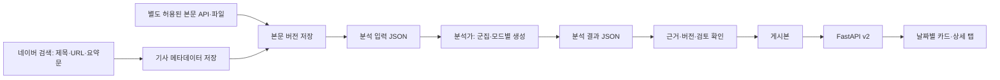

# 네이버 검색·본문·군집·LLM 모드 개발 가이드

기준일 2026-10-22. 정채은·최민준·분석가가 같은 형식으로 병렬 개발하기 위한 실제 구현 기준입니다.

## 1. 이번 판단의 핵심

**네이버 뉴스 검색 API도 기사 전문을 반환하지 않습니다.** `description`은 검색용 요약문입니다. 응답에는 제목, 원문 URL, 네이버 URL, 요약문, 제공 시각이 있으며 본문 필드는 없습니다. API 자체에는 매체명·카테고리·저자도 없습니다. [공식 명세](https://developers.naver.com/docs/serviceapi/search/news/news.md)

따라서 네이버 API는 **기사 발견·링크 확보**에 사용하고, 분석용 본문은 사용 범위가 확인된 별도 제공처 또는 분석가가 확보한 JSON으로 연결합니다. URL이 있다고 본문을 자동 크롤링하거나 검색 요약문을 전문이라고 저장하지 않습니다. 현재 자동 전문 수집기는 구현하지 않았습니다.

네이버 검색은 검색어 기반의 일부 결과입니다. 같은 검색어의 결과를 많이 모으는 것만으로 전체 뉴스나 다양한 관점을 확보했다고 판단하지 않습니다. 분석가는 검색어·기간·매체 분포도 함께 확인합니다.

## 2. 지금 완료된 범위

| 구분 | 상태 |
| --- | --- |
| 네이버 검색 클라이언트 | 구현. 서버 전용 키, 입력 한도·오류 코드·HTML 정리·중복 식별 처리. 모의 HTTP로 검증 |
| 개발 Supabase | **신규 private 테이블 9개 실제 적용**. 기존 RSS·공개 기사 테이블 유지 |
| 실제 네이버 호출 | 키가 제공되지 않아 미실행. 로컬 `.env.news`에 직접 설정 후 실행 |
| 실제 기사 전문 | 아직 이 작업에서 확보하지 않음. 별도 본문 입력 경로 필요 |
| 분석 입출력 | JSON 스키마·예시·버전/근거 검증·입출력 CLI 구현 |
| 실제 군집·LLM 모델 | 분석가 코드와 모델 제공자를 연결해야 함. 모델 실행/성능 향상을 검증했다고 주장하지 않음 |
| 서비스 연결 | 로컬 PostgreSQL → API → 날짜별 카드 → 요약·5W·쉬운 설명·감정/어조·본문 공개 분기 검증 |
| 기존 화면/API | 기본 v1 경로 유지. v2는 명시적으로 선택 |

Supabase 확인 결과: 기존 RSS 항목 5개·공개 기사 7개 유지, 새 본문 행 0개, 신규 테이블 9개 모두 RLS 활성화, anon/authenticated 본문 SELECT 불가, service_role SELECT 가능. 이는 임의의 운영 전체 보안 감사를 완료했다는 뜻은 아닙니다.

## 3. 전체 흐름



상세 흐름 원본: `docs/architecture/news-v2-flow.mmd`. 테이블 관계: `news-v2-erd.mmd`.

검색·본문 입력·분석·게시를 별도 작업으로 실행합니다. 화면 요청은 저장된 결과를 조회합니다. 카드나 탭을 누를 때 수집·군집·LLM을 다시 실행하지 않습니다.

## 4. 데이터는 다섯 번의 전달로 이해하면 됩니다

### A. 네이버 → 수집 코드: 검색 결과 JSON

```json
{
  "lastBuildDate": "Thu, 22 Oct 2026 03:30:00 +0900",
  "total": 1,
  "start": 1,
  "display": 1,
  "items": [{
    "title": "야간 <b>버스</b> 시범 운행",
    "originallink": "https://press.example.com/article/1",
    "link": "https://example.com/naver-demo-1",
    "description": "검색용 짧은 요약문입니다. 기사 전문이 아닙니다.",
    "pubDate": "Thu, 22 Oct 2026 01:00:00 +0900"
  }]
}
```

위 URL·내용은 설명용 가상 값입니다. 공식 요청은 GET `https://openapi.naver.com/v1/search/news.json`, 헤더는 `X-Naver-Client-Id`, `X-Naver-Client-Secret`입니다. query 필수, display 최대 100, start 최대 1000, sort는 sim/date입니다. 공식 문서상 검색 API 일일 호출 한도는 25,000회이며 키별 사용량을 확인해야 합니다. 현재 CLI는 한 번에 한 페이지만 요청하고 429를 오류로 반환하므로 무제한 재시도하지 않습니다.

| 네이버 필드 | 저장·변환 |
| --- | --- |
| title | HTML 강조 태그·엔티티를 일반 문자열로 정리 |
| originallink | 원문 주소 우선. 없으면 link 사용 |
| link | provider_url로 별도 보존. 원문과 같을 수도 있음 |
| description | snippet. 본문·LLM 요약으로 사용하지 않음 |
| pubDate | provider_published_at. 네이버 제공 시각이며 언론사 원 발행 시각과 구분 |
| 매체 정보 없음 | 원문 도메인을 검토된 publisher-map과 연결. 미해결이면 분석 보류 |
| 카테고리 없음 | 우선 수집 query에 지정한 분류로 저장, category_basis=collection_query. 분석가 검토 분류와 구분 |

같은 canonical URL은 같은 UUID 기사로 식별합니다. utm 추적 변수와 fragment만 제거하고 기사 ID처럼 의미 있는 query는 보존합니다. 같은 기사가 다른 검색어로 발견돼도 기사 하나·수집 관측 이력 여러 개로 저장합니다.

### B. 본문 제공처/분석가 → 개발자: 본문 JSON

완전한 예시: `contracts/news-v2/examples/bodies.json`. 검사 기준: `bodies.schema.json`.

필수 정보는 기사 ID, 실제 본문 text, 전문/발췌 구분, 취득 경로·시각, 추출기 버전, 원 출처, 이용 범위와 근거입니다. `article_id`는 수집 코드에서 만든 UUID를 그대로 사용합니다. 검색 요약문을 붙여 놓고 `content_kind=full_text`로 표시하지 않습니다.

```json
{
  "article_id": "수집 단계에서 반환한 UUID",
  "content_kind": "full_text",
  "text": "본문 제공처에서 확보한 기사 전문",
  "source_kind": "licensed_api",
  "source_url": "https://press.example.com/article/1",
  "acquired_at": "2026-10-22T04:00:00+09:00",
  "extractor_version": "licensed-provider-v1",
  "rights": {
    "store": true,
    "cluster": true,
    "summarize": true,
    "analyze": true,
    "publish_summary": true,
    "display_full_text": false,
    "evidence": "실제로 확인한 제공처·계약·이용 범위의 근거"
  }
}
```

위 UUID 자리표시자는 설명용입니다. 실행에는 실제 예시 파일 또는 실제 수집 UUID를 사용합니다. `rights`는 모든 기사를 true로 설정하라는 지시가 아닙니다. 확인한 이용 범위를 전달하는 필드이며 자체적으로 권리의 유효성을 검증하지 않습니다. `source_url`에는 비밀 토큰이 들어간 서명 URL을 넣지 않습니다.

본문 변경 시 해시와 새 본문 버전을 만듭니다. 동일 본문/출처/이용 범위를 다시 넣으면 중복 버전을 만들지 않으며, 오래된 파일을 재입력해도 최신 본문을 되돌리지 않습니다.

### C. 개발자 → 분석가: 분석 입력 JSON

`export-analysis`가 `AnalysisBatch`를 만듭니다. 예시: `examples/analysis-input.json`.

| 필드 | 의미 |
| --- | --- |
| run_id | 이번 분석 입력 묶음의 고유 ID |
| input_hash | 기사·본문 버전·분석 관련 메타데이터의 조합 식별값 |
| articles[].article | 기사 ID, 제목, 매체/그룹, 분류 근거, 두 종류 발행시각 |
| body_version_id / content_hash | 정확히 어떤 본문을 분석했는지 식별 |
| text / text_basis | 실제 분석 텍스트와 전문/발췌 구분 |
| rights | 군집·LLM·분석·공개에 허용된 범위 |
| excluded | 본문 없음·날짜 없음·매체 미확인·너무 짧음 등의 보류 건수 |
| selection | 조회 상한·전체 후보 수·검토한 수·잘림 여부 |

기본은 전문 200자 이상이며 500개 후보를 확인합니다. 200자는 개발용 최소 길이 기준이지 ‘좋은 본문’의 증명이 아닙니다. `--min-chars`와 `--limit`(최대 1000)을 조절할 수 있습니다. `selection.truncated=true`면 전체 데이터셋이 아니며 추가 기간/작업 분할 설계가 필요합니다. 발췌는 기본 제외하고 비교 실험에서 `--allow-excerpt`로 명시적으로 포함합니다.

현재는 본문을 JSON 파일로 전달하므로 분석가는 기존 Python 모델을 그대로 사용할 수 있습니다. 임베딩 모델과 차원이 결정되기 전에 pgvector 차원을 고정하거나 대형 AI 프레임워크를 추가하지 않았습니다.

### D. 분석가 → 개발자: 군집·모드별 결과 JSON

예시: `examples/analysis-result.json`, 검사 기준: `analysis-result.schema.json`.

```text
ResultBatch
 ├─ run_id / input_hash       ← 입력 파일의 값을 그대로 반환
 ├─ cluster_model_version
 └─ clusters[]
     ├─ event_key             ← 같은 사건의 재분석에도 유지할 사건 키
     ├─ article_ids[]         ← 이번 입력에 존재하는 기사만
     ├─ same_event_verified   ← 동일 사건 확인 상태
     ├─ category              ← 검토한 사건 분류, 선택
     └─ outputs[]
         ├─ mode             ← summary / five_w / easy / sentiment
         ├─ status           ← ready / failed / insufficient_sources
         ├─ model_version / prompt_version
         └─ payload          ← 모드별 구조, 비완료 상태는 null
```

| 모드 | payload | 화면 |
| --- | --- | --- |
| summary | title, bullets, perspectives, unknowns | 메인 제목·요약 첫 문장, 상세 전체 요약 |
| five_w | who/what/when/where/why의 근거 문장 또는 null, unknowns | 팩트 5W 탭. 모르는 항목은 ‘근거 없음’ |
| easy | 근거가 있는 paragraphs와 glossary, unknowns | 쉬운 설명·낱말 풀이 |
| sentiment | article_language 범위, 기사별 label/confidence/evidence | 기사 표현의 감정·어조. 진위·정치 성향·독자 감정 점수가 아님 |

요약·5W·쉬운 설명의 문장은 `{text, article_ids}` 형식으로 근거를 연결합니다. 감정/어조 근거는 해당 본문에 존재하는 인용문인지 검사합니다. 본문 재표시 범위가 없는 기사의 직접 인용은 공개 응답에서 생략합니다. confidence가 있어도 정확도나 진실 확률로 표시하지 않습니다.

본문 해시가 달라진 결과, 다른 run_id/hash, 사건에 속하지 않는 근거 기사, 중복 기사 배정은 거부합니다. 이 검사는 형식·출처 연결을 확인하며 문장의 사실성까지 자동 증명하지는 않습니다.

### E. 개발자 → 사용자: 검토된 공개 응답

분석 결과를 import한 것만으로 공개되지 않습니다. `publish --reviewed`로 검토한 모드만 게시합니다. 기본은 summary만 승인하며 나머지는 `--modes summary five_w easy sentiment`처럼 명시합니다.

- 같은 사건 확인, 독립 매체 그룹 2곳 이상, 본문/분석/게시 이용 범위를 확인합니다.
- 메인 카드: 저장된 사건 제목·요약 첫 문장·기사 수·매체 이름을 사용합니다.
- 상세: 전체 요약, 근거 기사, 원문 링크와 추가 모드를 표시합니다.
- 본문 재표시가 허용되지 않으면 원문 링크만 제공합니다. 분석용 본문 확보와 서비스 전문 재게시는 별개입니다.
- 본문이나 분석 관련 메타데이터가 바뀌면 예전 게시본·분석을 현재 결과처럼 반환하지 않습니다. 새 분석·검토 전에는 조회에서 보류됩니다.

## 5. DB 구성과 기존 구조의 관계

신규 테이블은 모두 `private.news_v2_*`입니다.

| 테이블 | 저장 대상 |
| --- | --- |
| articles | URL로 식별한 기사 메타데이터, 현재 본문 포인터 |
| observations | 네이버/RSS 등 발견 경로·검색어·원래 입력 이력 |
| bodies | 전문/발췌 텍스트, 해시, 출처와 이용 범위 버전 |
| runs | 분석 입력 묶음과 hash |
| run_inputs | 분석에 사용한 기사 메타데이터·본문 버전 스냅샷 |
| events | 사건 키, 현재 분석 run, 군집 모델 버전 |
| members | 사건에 속한 기사 |
| analyses | 모드·모델·프롬프트별 결과와 검토 상태 |
| publications | 승인된 summary로 만든 화면용 게시본 |

기존 public.stories/articles와 private.rss_*는 보존했습니다. v2 게시본은 새 비공개 파이프라인의 단일 읽기 결과이며 public.stories에 이중으로 쓰지 않습니다. 기존 FastAPI main.py는 계속 기존 자료를 읽고, **새 API는 app.news_api**를 사용합니다. 두 경로를 동시에 같은 데이터의 최신본이라고 취급하지 않습니다. 데이터가 안정된 뒤 레거시 조회 경로를 정리할 수 있습니다.

본문은 브라우저가 Supabase Data API로 직접 읽지 않습니다. FastAPI가 게시·권한·최신 버전을 확인합니다. 네이버 키와 DB 자격 증명도 서버에만 둡니다.

## 6. API와 날짜 기준

| 요청 | 응답 |
| --- | --- |
| GET `/api/v2/stories?date=2026-10-22` | 해당 날짜 사건의 페이지. q/category/limit/cursor 지원 |
| GET `/api/v2/stories?from=2026-10-01&to=2026-10-22` | 기간 내 게시 사건 전체에서 페이지 조회 |
| GET `/api/v2/categories` | 현재 게시 가능한 사건 수 |
| GET `/api/v2/stories/{id}` | 기존 Story 형식 + event_date |
| GET `/api/v2/stories/{id}/analyses/{mode}` | ready/pending 등 상태와 저장된 모드 결과 |
| GET `/api/v2/stories/{id}/articles/{article_id}/content` | available이면 본문, link_only이면 원문 안내 |

`event_date`는 해당 사건에서 가장 이른 기사 시각을 한국 시간으로 환산한 날짜입니다. 언론사 발행시각을 확보했으면 그 시각, 없으면 네이버 제공시각을 사용합니다. 수집 시각으로 임의 대체하지 않습니다. 하루가 지났다고 옛 사건을 오늘 카드로 다시 날짜 변경하지 않습니다.

v2는 DB에서 날짜를 필터링하므로 ‘처음 불러온 6개’만 날짜 검색하는 방식이 아닙니다. 현재 정렬은 날짜순입니다. 기존 v1의 다양성 정렬과 형식은 유지하고 v2에 검증되지 않은 추천 점수를 붙이지 않았습니다. date와 from/to는 함께 보낼 수 없습니다.

기존 `contracts/openapi.json`·`schema.d.ts`는 변경하지 않았습니다. 새 명세·타입은 `contracts/news-v2/openapi.json`, `frontend/src/api/news-v2-schema.d.ts`입니다.

## 7. 실행 순서 — 실제 소스 연결

프로젝트 루트 PowerShell에서 새 의존성을 설치합니다.

```powershell
python -m pip install -r backend/requirements-news.txt
Copy-Item backend/.env.news.example backend/.env.news
```

**backend/.env.news 파일을 VS Code에서 직접 편집**하여 NEWS_DATABASE_URL과 네이버 키를 설정합니다. Dashboard Connect의 PostgreSQL 연결 문자열을 사용합니다. 연결 문자열에는 필요한 TLS 설정을 유지하고 서버 환경에 맞는 연결 경로를 선택합니다. 키를 채팅·GitHub·VITE_ 변수에 넣지 않습니다. [.env 관련 서버 기준](https://supabase.com/docs/guides/database/connecting-to-postgres).

`contracts/news-v2/examples/publisher-map.json`은 가상 매체 예시입니다. 실제 운영 매체의 원문 도메인·ID·이름·소유 그룹으로 검토한 별도 파일을 만들어야 합니다.

```powershell
python -m backend.app.news.cli --env-file backend/.env.news collect --query '반도체' --category technology --publishers data/private/publisher-map.json
python -m backend.app.news.cli --env-file backend/.env.news import-bodies data/private/bodies.json
python -m backend.app.news.cli --env-file backend/.env.news export-analysis --out data/exports/analysis-input.json
```

분석가가 결과 파일을 반환하면 다음을 실행합니다.

```powershell
python -m backend.app.news.cli --env-file backend/.env.news import-results data/private/analysis-result.json
python -m backend.app.news.cli --env-file backend/.env.news publish --event-id '반환된 사건 UUID' --reviewed --modes summary five_w easy sentiment
```

`publish`의 모드는 실제로 검토한 ready 결과만 지정합니다. 본문/파일 수집·실제 모델 호출·사람의 검토는 자동으로 완료된 것으로 처리하지 않습니다.

API 터미널:

```powershell
$env:NEWS_ENV_FILE='backend/.env.news'
python -m uvicorn app.news_api:app --app-dir backend --host 127.0.0.1 --port 8000
```

프론트 터미널:

```powershell
cd frontend
$env:VITE_NEWS_API_VERSION='v2'
npm.cmd run dev:http
```

v1으로 돌아가려면 프론트 변수 값을 v1으로 바꾸고 기존 connection_api를 실행합니다. `/health`는 서버 생존 확인이며 실제 DB 확인은 `/api/v2/stories`로 합니다.

## 8. 실제 소스를 기다리지 않는 로컬 검증

개발자가 별도로 만든 **로컬 PostgreSQL 테스트 DB**에 migration을 적용한 뒤 `NEWS_DATABASE_URL`을 그 DB로 설정하고 아래를 실행할 수 있습니다. Supabase 개발 DB에는 가상 기사를 넣지 않았습니다.

```powershell
python -m backend.app.news.cli seed-demo
```

가상 기사 3개·본문 3개·사건 1개·모드 4개의 저장 결과를 만듭니다. 자동 모델 실행이 아닌 직접 작성한 예시이며 화면에도 표시합니다. seed-demo는 원격 DB에서 실행되지 않도록 제한했습니다.

DB 테스트는 localhost의 이름이 `_test`로 끝나는 별도 DB만 허용합니다.

```powershell
$env:NEWS_TEST_DATABASE_URL='별도 localhost 테스트 DB URI'
python -m unittest discover -s backend/tests -v
```

UI 테스트·빌드는 frontend에서 `npm.cmd test`, `npm.cmd run build`입니다. 로컬 테스트 컨테이너는 작업 후 종료했으므로 새 검증 때 다시 시작해야 합니다.

## 9. Supabase 적용 기록

- migration: `database/supabase/migrations/20261022055246_naver_ingestion_and_story_modes.sql`.
- CLI로 파일을 생성하고 일회용 PostgreSQL 17에 적용·검증한 뒤, 인증된 Dashboard Explorer에서 개발 프로젝트에 적용했습니다.
- 도구 연결의 프로젝트 권한이 거부되어 일반 대시보드 SQL 실행을 사용했습니다. 최초 편집기 입력 중 기존 SQL이 남아 구문 오류가 났고, 전체 내용을 교체한 후 정상 적용했습니다. 실패한 SQL은 구문 분석 단계에서 중단됐습니다.
- **Supabase CLI migration history에는 자동 등록하지 않았습니다.** 현재 프로젝트에서 해당 이력 테이블이 관측되지 않았습니다. 이미 만들어진 개발 DB에 이 SQL을 다시 실행하지 말고, 향후 CLI 이력을 도입할 때 이 버전을 applied로 정리해야 합니다. 다른 새 DB에는 이 파일을 한 번 적용합니다.
- 검증 근거: `docs/worklogs/2026-10-22-news-v2-supabase-verification.json`과 작업 로그. 신규 테이블은 모두 RLS를 사용하며 anon/authenticated에 권한을 주지 않았습니다. [Supabase RLS 기준](https://supabase.com/docs/guides/database/postgres/row-level-security).

## 10. 분석 정확도를 평가하는 다음 작업

분석가는 **같은 정답 사건 집합**에서 제목+검색 요약문 입력과 본문 입력을 비교합니다. 다른 기사 집합으로 비교하면 본문 확보 효과와 데이터 구성 차이를 구분하기 어렵습니다. 사건을 잘못 합친 수·같은 사건을 놓친 수, 매체별 차이, 본문 확보율·누락률을 기록합니다.

본문에 광고·관련 기사·댓글이 섞이면 성능이 나빠질 수 있습니다. 본문 길이만으로 충분성을 판정하지 말고 추출 품질과 동일 사건 예시를 확인합니다. 같은 사건이나 동일 기사의 변형이 학습/평가 양쪽에 들어가지 않도록 나눕니다. 현재 구현은 이 평가를 재현하기 위한 입력 버전·모델 버전·근거를 남깁니다.
