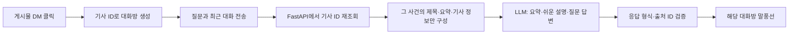

# 뉴스 DM·댓글·테마 · 2026-10-22

**현재 사용 제공자는 엘리스입니다.** 엘리스 키를 OpenAI 직접 API 주소에 보내지 않습니다. 먼저 [엘리스 연결 안내](ELICE_NEWS_DM.md)를 확인해 주세요. 아래 OpenAI 키 설정은 `PRISM_CHAT_PROVIDER=openai`를 명시한 직접 사용에만 해당합니다.

## 지금 사용할 수 있는 기능

- 상단 달/해 아이콘: 라이트·다크 전환. 브라우저에 선택을 저장하고 첫 방문은 시스템 설정을 따릅니다.
- 달력 아이콘·날짜 토글·기간 선택 UI 제거. 원형 스토리는 **현재 로드한 뉴스의 날짜별 묶음**입니다. '뉴스 더 보기'로 이전 페이지를 읽으면 날짜 묶음도 추가됩니다.
- 댓글 아이콘: 기사별 댓글 창, 작성·조회·삭제. 현재는 이 브라우저에만 저장되며 다른 이용자에게 공개되지 않습니다.
- 게시물 DM 아이콘: 해당 사건의 전용 프로필과 대화방 생성 → 메시지 화면으로 이동.
- 하단 세 번째 메뉴: **게시물의 DM을 누른 뉴스만** 메시지 목록에 표시. 반복해서 눌러도 같은 사건의 방을 중복 생성하지 않습니다.
- 두 번째 메뉴: 기존 카테고리 필터를 유지하고 홈과 같은 작은 제목·폰트로 통일했습니다.
- 실제 LLM 연결 코드: FastAPI → OpenAI Responses API. 요약·쉬운 설명·기사 질문을 처리하며, 키/모델 미설정 시 답변을 꾸며내지 않습니다.

## 로컬 실행

프론트는 기존 서버 http://127.0.0.1:5183/ 에서 확인할 수 있습니다. DM 상태 조회를 위한 별도 FastAPI 서버는 http://127.0.0.1:8004/ 입니다. 현재 AI는 미설정 상태입니다.

프로젝트 루트의 VS Code 터미널 1:

```powershell
python -m pip install -r backend/requirements.txt
$env:CORS_ORIGINS='http://127.0.0.1:5183,http://localhost:5183'
python -m uvicorn app.api:app --app-dir backend --host 127.0.0.1 --port 8004
```

터미널 2:

```powershell
cd frontend
$env:VITE_API_MODE='mock'
$env:VITE_NEWS_API_VERSION='v1'
npm.cmd run dev -- --port 5183
```

이미 해당 포트의 개발 서버가 실행 중이면 새로 실행하지 않고 기존 창을 사용합니다. Vite는 `/api/social`만 8004로 프록시합니다. 기존 뉴스 목록/상세 Mock 요청은 MSW에서 그대로 처리합니다. `vite preview`에는 이 개발용 프록시가 없으므로 배포 시에는 동일 경로를 FastAPI로 연결해야 합니다.

## 실제 LLM 답변 켜기

1. `backend/.env.chat.example`을 **아직 없는 경우에만** `backend/.env.chat.local`로 복사합니다.
2. 로컬 파일을 직접 열어 아래 값을 작성합니다. 키는 채팅·GitHub·`VITE_*` 변수에 넣지 않습니다.

```dotenv
PRISM_CHAT_PROVIDER=openai
OPENAI_API_KEY=서버에서_사용할_키
OPENAI_CHAT_MODEL=프로젝트에서_사용_가능한_모델_ID
PRISM_CHAT_ENABLED=1
PRISM_DATA_SOURCE=fixture
CORS_ORIGINS=http://127.0.0.1:5183,http://localhost:5183
```

3. 모델은 Responses API의 Structured Outputs를 지원하는 모델을 선택합니다. [공식 모델 목록](https://developers.openai.com/api/docs/models)을 확인합니다. 계정에서 사용 가능한 모델은 별도로 확인해야 합니다.
4. FastAPI 8004 서버를 재시작하고 DM의 '연결 다시 확인'을 누릅니다.
5. 게시물 DM → '이 기사를 세 줄로 요약해줘' 또는 직접 질문을 전송합니다.

설정 값은 서버에서만 읽습니다. `GET /api/social/chat/status`의 configured는 **활성화 플래그와 키·모델의 존재 여부**이며 실제 인증 성공을 뜻하지 않습니다. 실제 인증·모델·한도 오류는 질문 전송 시 사용자에게 안전한 문구로 표시합니다. 실제 모델 응답은 키가 준비된 뒤 확인해야 합니다.

현재 전용 API는 로컬 개발용으로 클라이언트 IP·Origin을 제한하고 1분 10회 제한과 직렬 실행을 적용했습니다. 로그인/사용자별 과금·권한 처리가 없는 채로 공개 배포하지 않도록 코드에서 로컬 접근만 허용합니다. 프록시 헤더로 원격 IP를 임의 신뢰하지 않습니다.

## 기사에 한정하는 구조



프론트가 임의 기사 본문이나 시스템 프롬프트를 주입하는 필드는 허용하지 않습니다. 서버에서 기존 `PRISM_DATA_SOURCE` reader로 해당 사건을 다시 찾습니다. 다른 사건의 출처 ID가 출력되면 응답을 거부합니다. 모델에 외부 검색·도구 권한을 주지 않고, 선택 사건 밖 질문이나 없는 사실은 확인 불가로 답하도록 지시합니다. 이 제한은 모델의 모든 환각이 사라진다는 보장은 아니며, 실제 답변 품질 검증은 별도입니다.

**현재 기존 Story 계약에 전문이 없기 때문에 기사 제목·dek·준비된 요약·관련 기사 제목/매체/발행 시각/프레이밍을 참고합니다. 전문을 읽었다고 표시하지 않습니다.** 분석가 본문 연결 후에는 서버 `context_for()`에서 승인된 본문만 추가하면 UI 구조를 다시 만들 필요가 없습니다. 사건 전체 본문을 브라우저가 매번 전송하는 방식으로 변경하지 않습니다.

요청은 `store: false`, 구조화 JSON 출력으로 생성하며 서버 로그·오류에 키/제공자 원본 오류를 노출하지 않습니다. 외부 제공자 요청에 관한 세부 동작은 [공식 Structured Outputs 문서](https://developers.openai.com/api/docs/guides/structured-outputs)를 참고했습니다. `store: false`를 모든 제공자 데이터 보존 면제로 해석하지 않습니다.

## 새 API 계약

기존 `/api/v1/stories` 응답은 수정하지 않았습니다. 새 명세는 `contracts/social-v1/openapi.json`, 프론트 생성 타입은 `frontend/src/api/social-schema.d.ts`입니다.

```http
GET /api/social/chat/status
POST /api/social/stories/{story_id}/chat
Content-Type: application/json
```

```json
{
  "question": "이 기사를 세 줄로 요약해줘",
  "history": [
    {"role": "user", "content": "이 뉴스의 주제가 뭐야?"},
    {"role": "assistant", "content": "이전 답변"}
  ]
}
```

```json
{
  "answer": "선택한 기사에 근거한 설명",
  "article_ids": ["해당 사건에 포함된 실제 article_id"],
  "model": "서버에서 설정한 모델 ID",
  "context_notice": "현재 제목·제공된 요약·관련 기사 정보만 참고합니다. 원문 전문은 연결되지 않았습니다."
}
```

위 응답은 형식 예시이며 실제 LLM 실행 결과가 아닙니다. 질문 최대 2,000자, history 최대 10개·각 5,000자입니다. 오류는 기존 error.message/request_id 규칙을 사용합니다. 설정 미완료 503, 없는 기사 404, 형식 오류 422, 외부 오류/출처 검증 실패 502, 한도 초과 429입니다.

## 최민준님께 전달할 내용

기존 RSS 목록·상세 API는 그대로 유지해 주세요. 새 `app.api:app`는 기존 `connection_api`의 v1 라우트에 DM 라우트를 추가한 개발용 진입점입니다. `main.py`, 기존 RSS/DB 모듈을 덮어쓰지 않았습니다.

실제 RSS 서버에 통합하실 때에는 `social_chat.router`를 기존 FastAPI 앱에 등록하고, `find_story()`에서 현재 사건을 조회하는 공통 repository를 연결해 주세요. `PRISM_DATA_SOURCE=rss-reader`를 쓰려면 해당 checkout에 실제 reader가 있어야 하며, DB 실패 시 fixture로 대체하지 않습니다. 가상 뉴스 모드와 실제 뉴스 모드가 서로 다른 ID를 사용하지 않도록 확인해 주세요.

추후 공동 댓글·기기 간 DM 동기화는 Supabase Auth 사용자 ID 기반 테이블/RLS/API가 별도로 필요합니다. 이번에는 DB를 변경하지 않았으며, 로컬 댓글을 이미 공개 댓글인 것처럼 표시하지 않습니다. 본문 저장과 분석·외부 LLM 전송 허용 범위는 분석가 데이터 계약에서 확인해 주세요.
