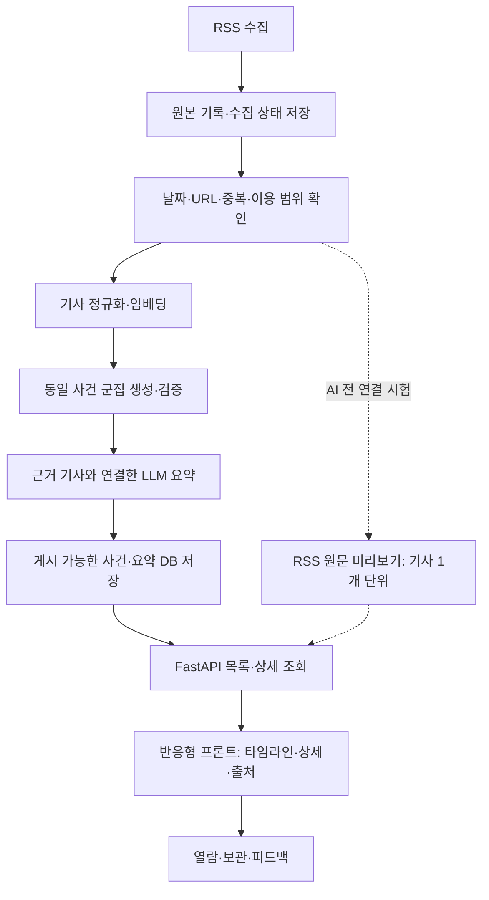

# 프리즘 개발 지도 — 정채은·최민준

**후속 업데이트:** 네이버 검색·별도 본문·버전별 분석·모드별 게시 구조와 분석 탭을 추가했습니다. 개발 Supabase 테이블 9개는 적용했고 실제 네이버 키 수집·본문 확보·모델 연결은 남아 있습니다. 최신 실행·분담 기준은 `NAVER_NEWS_V2_GUIDE.md`와 `NEWS_V2_LOCAL_RUN.md`입니다. 아래 단계별 설명은 v1 연결을 완료한 당시 기준으로 보존합니다.

기준일: 2026-10-22. 이 문서는 이번 로컬 구현과 확인 결과를 기준으로 합니다. GitHub 병합·운영 배포 완료를 뜻하지 않습니다.

## 1. 지금 어디에 있나요?

**현재는 ‘화면과 API를 가상 자료로 연결 완료 → 실제 RSS·DB 연결 대기’입니다.**

기획·ERD·API 형식이 준비되었고, 정채은 담당의 보라색 모바일 화면과 실제 HTTP 연결을 구현했습니다. 최민준 담당의 RSS 수집·저장·reader가 같은 내부 JSON을 반환하면 데이터 소스만 바꾸어 첫 실제 기사 연결을 확인할 수 있습니다. 지금부터 UI를 다시 설계하거나 DB가 끝날 때까지 멈출 필요는 없습니다.

| 큰 목표 | 완료 기준 | 현재 상태 |
| --- | --- | --- |
| A. 가상 자료로 한 바퀴 | 카드 → 상세 → 출처, 검색·저장, HTTP API 연결 | 로컬 검증 완료 |
| B. 실제 기사로 한 바퀴 | RSS → Supabase → reader → FastAPI → 화면 | 다음 합류 목표 |
| C. 여러 기사를 하나의 사건으로 | 전처리 → 군집 검증 → 근거가 있는 요약 | 이후 구현·품질 평가 필요 |
| D. 사람들이 쓰는 서비스로 | 자동 실행·오류 복구 → 배포 환경 → 소규모 검증 → 공개 | 이후 진행 |

마이페이지 디자인이 있다는 사실과 실제 편향 평가 모델이 있다는 사실은 다릅니다. 현재 열람 통계·보관함은 브라우저 저장이며, 실제 밸런스 점수는 제공하지 않습니다.

## 2. 서비스가 작동하는 흐름

수집·군집·요약은 별도 작업 프로세스에서 실행하고 결과를 저장합니다. 사용자가 카드를 열 때마다 RSS 전체 수집이나 LLM 생성을 새로 실행하는 구조로 만들지 않습니다. 지금의 RSS 미리보기는 연결 시험용 우회 경로이며 최종 사건 군집이 아닙니다.

## 3. 처음부터 배포까지 단계별 작업

상태의 ‘완료’는 아래 범위만 의미합니다. 기간은 숙련도와 수집 허용 범위에 따라 달라지므로 완료 기준으로 다음 단계에 진입합니다.

### 0단계. 서비스 범위 정하기 — 기획 초안 준비됨

- 입력: 기존 기능정의서와 확증편향 방지 목표.
- 정채은: 첫 화면 → 사건 상세 → 여러 출처 확인의 사용자 흐름을 정의합니다.
- 최민준: RSS 입력과 기사·사건·요약의 저장 흐름을 확인합니다.
- 완료 기준: MVP는 4개 분야, 사건 목록·상세·검색·출처 연결, 수집부터 요약 게시까지입니다. 개인 정치 성향 추정·정확한 밸런스 점수·복잡한 개인화는 별도 검증 과제로 둡니다.
- 남은 결정: 게시할 소스·사용 범위, 시범 사용자 범위, 1차 공개 시 로그인 필요 여부.

### 1단계. 협업 기준 고정 — 설계 자료 준비·전달됨

- 입력: ERD v1, 공개 OpenAPI, 내부 RSS v1 JSON과 XML 테스트 자료.
- 정채은: 화면에서 사용하는 공개 API 형식을 유지합니다.
- 최민준: migration과 RSS 저장 구조를 만들고 내부 reader 반환 형식을 맞춥니다.
- 완료 기준: 서로 다른 코드에서 같은 예시 JSON을 읽을 수 있습니다. ERD 문서는 설계이며 실제 DB 적용 여부는 migration 기록으로 별도 확인합니다.
- 다음: 이미 보낸 ZIP을 기준으로 진행합니다. 새 문서를 계속 만들어 작업 시작을 미루지 않습니다.

### 2단계. 가상 데이터로 화면 구현 — 로컬 기본 기능 완료

- 정채은: 보라색 모바일 타임라인, 날짜 탐색, 카테고리, 검색, 상세 탭, 원문 목록, 로딩·빈 결과·오류·요약 대기 상태를 구현했습니다. PC에서는 넓은 피드와 보조 설명 영역으로 배치합니다.
- 저장·열람 통계는 브라우저 단위입니다. 로그인·계정 동기화와 실제 편향 점수는 미연결입니다.
- 완료 기준: 데이터 없이도 Mock으로 실행되고 사용자가 목록·상세·출처를 이동할 수 있습니다.
- 확인: 프론트 테스트 44개, 타입 검사·프로덕션 빌드 통과. 320/390/1280px에서 가로 넘침 없음 확인.

### 3단계. 프론트 → 실제 HTTP API 연결 — 이번 작업 완료

- 정채은: 기본 쿼리, CORS, 공통 오류, 요청 ID, 페이지 추가 로드, 연결 상태 표시, RSS 샘플 표시 adapter를 구현했습니다.
- 사용: `app.connection_api:app`과 `npm.cmd run dev:http`를 함께 실행합니다. 상세 실행법은 `CONNECTION_GUIDE.md`에 있습니다.
- 완료 기준: MSW가 아닌 FastAPI 응답으로 목록과 상세가 표시됩니다. 원문 미리보기와 AI 요약 카드를 구분합니다.
- 확인: 가상 사건 12개 HTTP 목록·상세, RSS 샘플 2개 중 1개 표시·날짜 없는 1개 보류, 허용 Origin CORS, 404/422, 브라우저 검색·상세·추가 로드·마이페이지.
- 한계: 연결 대상은 로컬 샘플입니다. 실제 RSS 수집·Supabase 조회까지 검증한 결과가 아닙니다.

### 4단계. 실제 RSS → DB → 화면 — 지금 두 사람이 합류할 다음 단계

**최민준**

1. 전달받은 XML로 파서를 구현·시험합니다. 본문/설명·작성자·날짜 누락을 처리합니다.
2. RSS migration을 작성·적용하고 수집·정규화·저장 코드를 구현합니다. 기존 테이블 데이터를 보존합니다.
3. 같은 자료를 두 번 넣어도 중복이 늘지 않는지 확인합니다. 다른 피드의 동일 URL도 확인합니다.
4. `backend/app/rss/reader.py`의 `list_rss_records(limit=100)`가 내부 RSS v1 dict 배열을 반환하도록 구현합니다.
5. 허용 범위를 확인한 소스 1개에서 5~10개를 수집해 수집 수·저장 수·보류 수·중복 수를 기록합니다. 저장 실패를 빈 배열로 숨기지 않습니다.

**정채은**

1. 지금은 `rss-fixture`로 화면과 상태를 계속 확인합니다.
2. reader가 준비되면 동일 체크아웃에 연결 파일을 반영하고 `PRISM_DATA_SOURCE=rss-reader`로 전환합니다.
3. DB 레코드 하나의 URL·제목·발행시각이 API와 화면·원문 링크에 동일하게 연결되는지 확인합니다.
4. 누락 날짜·설명 없음·권한 미확인·빈 결과·서버 실패 화면을 확인하고 결과를 로그로 남깁니다.

완료 기준: 실제로 수집한 기록을 DB에서 읽어 화면에 표시하고, 재수집해도 중복되지 않습니다. 미리보기에는 ‘AI 분석 전’이 표시됩니다. 게시 범위가 미확인인 실기사는 공개 화면 표시에서 보류할 수 있습니다.

이 단계가 끝날 때까지 군집·LLM·로그인을 모두 구현할 필요는 없습니다.

### 5단계. AI 입력 데이터 준비 — 이후 진행

- 최민준: URL 정규화, 중복 식별, 발행시각·수집시각 구분, 기사 상태와 재처리 경로를 정리합니다. 사용할 수 있는 본문/설명만 분석 입력으로 전달합니다.
- 분석가: 같은 사건/다른 사건의 소규모 정답 예시와 짧은 기사·본문 없는 기사·속보 후속 기사 등의 평가 자료를 준비합니다.
- 정채은: 군집 전/처리 중/실패/출처 부족 표시를 유지합니다.
- 완료 기준: 한 기사 ID를 원문·전처리 입력까지 추적하고, 없는 본문을 임의로 채우지 않습니다.

### 6단계. 동일 사건 군집 — 이후 진행

- 분석가: 임베딩과 시간 범위를 정하고 유사도·오병합·누락을 평가합니다. K-means 결과를 동일 사건으로 곧바로 확정하지 않습니다. 주제가 같은 것과 사건이 같은 것은 다릅니다.
- 최민준: 분석 입력 조회와 사건·기사 연결 저장, 새 기사의 기존 사건 합류·재분류를 구현합니다.
- 정채은: 실제 군집 결과의 기사 수·매체 칩·제목·업데이트 시각을 표시합니다. 임시 미리보기 ID와 최종 사건 ID 변경 시 기존 저장 항목 처리도 점검합니다.
- 완료 기준: 사람이 읽고 사건 단위 묶음이 타당한지 확인한 평가 결과와 오류 예시가 남아 있습니다. 목표 수치는 평가 자료를 본 뒤 합의합니다.

### 7단계. 근거를 연결한 LLM 요약 — 이후 진행

- 분석가: 가치 판단·추측을 줄인 제목, 공통 사실, 서로 다른 쟁점, 미확인 사항의 생성 규칙과 평가 기준을 만듭니다.
- 최민준: 구조화된 출력 검증, 기사 ID 근거 연결, 모델/프롬프트 버전, 요약 이력, 실패·재시도·비용 상한을 구현합니다. 키는 서버에 둡니다.
- 정채은: 실제 요약·문장별 출처·불확실성·실패 상태를 기존 상세 화면에 연결합니다.
- 완료 기준: 요약 문장의 근거 기사와 실제 주장 일치를 사람이 확인합니다. 매체 수가 많다는 이유만으로 중립이라고 표시하지 않습니다. 출처 부족 시 요약을 보류합니다.

### 8단계. 다양한 뉴스를 보여주는 정렬 — 이후 진행

- 정채은: 기본 대표 뉴스와 탐색 폭 설정을 연결하고 추천 이유를 읽기 쉽게 표시합니다.
- 분석가: 출처·주제 분포, 특정 출처 과다 노출, 같은 사건 반복 노출을 측정합니다. 정치 성향을 검증 없이 매체 이름만으로 단정하지 않습니다.
- 최민준: 확정한 정책의 조회·정렬과 필요한 통계를 지원합니다.
- 완료 기준: 관련성과 주제·출처 다양성의 조정 방식이 설명되고, 실제 평가로 확인됩니다. 정렬을 구현한 사실만으로 확증편향 감소를 입증했다고 주장하지 않습니다.

### 9단계. 수집부터 게시까지 자동화 — 이후 진행

- 최민준: 수집·분석·요약을 순서대로 실행하는 별도 worker/스케줄과 작업 상태를 구현합니다. 실패 단계만 재시도하고 같은 작업의 중복 실행을 막습니다.
- 정채은: 최신 갱신 시각·지연 안내·예전 기사·일부 실패 시 화면을 확인합니다.
- 완료 기준: 수동 명령 없이 새 기사부터 게시까지 이어지고, 소스 장애나 요약 실패 후 복구됩니다. 실패 로그에 비밀 키나 원문 전체를 무분별하게 남기지 않습니다.

### 10단계. 계정·보관함·통계 정식 연결 — 공개 범위에 따라 선택

- 정채은: 로그인이 필요한 사용자 흐름과 계정 간 저장·열람 기록 연결을 구현합니다.
- 최민준: Supabase Auth와 사용자별 RLS, 보관함·열람 기록 API, 중복 저장·삭제를 구현합니다.
- 완료 기준: 다른 계정의 자료에 접근하지 못하고, 여러 기기에서 저장 내용이 일치합니다. 평가 모델이 없으면 밸런스 점수는 계속 ‘준비 중’으로 둡니다.
- MVP 선택: 계정 기능이 필수가 아니면 브라우저 저장 제한을 명시하고 첫 공개 이후로 미룰 수 있습니다.

### 11단계. 배포 전 시험 환경 만들기 — 이후 진행

1. 정채은: 프론트 배포 프로젝트, 빌드 명령·출력 폴더, SPA 경로 새로고침, HTTPS API 주소를 설정합니다. 프론트는 Vite `dist`를 정적 호스팅할 수 있습니다.
2. 최민준: FastAPI 실행 환경, 별도 worker, Supabase 서버 환경변수와 migration 절차를 준비합니다. Python 프로세스를 지원하는 호스팅을 사용합니다.
3. 정채은·최민준: 실제 프론트 도메인만 CORS에 허용하고, dev/배포 환경을 분리합니다. 서버 전용 DB 자격 증명을 `VITE_` 변수에 넣지 않습니다.
4. 둘이 함께: 모바일 실제 기기, 느린 네트워크, 빈 결과, 오류, 날짜 경계, 새로고침·공유 링크, 이용 범위·출처 표기, 접근성, 읽기/쓰기 권한을 확인합니다.
5. 배포용 프론트는 `VITE_API_MODE=http`로 빌드하고 Mock·예시 점수가 실제 서비스처럼 노출되지 않는지 확인합니다. 런타임에만 변수를 바꿔도 이미 빌드된 Vite 번들은 바뀌지 않습니다.
6. DB 백업/복원·migration 실패 복구, API 장애 시 이전 배포로 되돌리는 절차, 요약 비용 한도와 알림을 준비합니다.

완료 기준: 시험 URL에서 실제 DB·수집 결과·요약이 연결되며, 테스트 결과와 알려진 제한이 기록됩니다. 호스팅 공급자 선택과 운영 환경 설정은 이 단계에서 확정합니다.

### 12단계. 소규모 공개 → 운영 배포 — 이후 진행

- 정채은: 사용자가 대표 뉴스·여러 출처를 이해하는지 관찰하고 화면 오류를 수정합니다.
- 최민준: 수집 성공/실패·새 기사 지연·API 오류·worker 실패·중복·LLM 비용을 관찰합니다.
- 분석가: 잘못 묶인 사건·근거 없는 요약·출처 편중을 검토하고 수정 기준을 유지합니다.
- 완료 기준: 치명적 오류 수정, 공개 가능 데이터 범위 확인, 운영·복구 담당 지정 후 정식 도메인으로 배포합니다. 이후에도 RSS 형식 변화와 요약 품질을 계속 확인합니다.

## 4. 기다리지 않고 일하는 방법

| 상황 | 정채은이 계속하는 일 | 최민준이 계속하는 일 |
| --- | --- | --- |
| 실제 데이터가 아직 없음 | fixture/rss-fixture로 화면·오류·검색·날짜 검증 | XML 파서·중복 방지·DB 저장 테스트 |
| 화면이 아직 다듬어지는 중 | 320/390px·PC 사용 흐름 수정 | DB reader JSON·실행 명령·수집 결과 정리 |
| reader 준비됨 | 소스만 rss-reader로 바꾸어 통합 확인 | 실제 수집·재수집 검증, adapter 실패 입력 보완 |
| API 필드 변경 필요 | 변경 이유·기존 화면 영향과 호환 방법 제안 | DB 구조와 공개 응답을 분리해 가능한 호환 방식 검토 |

코드 소유: 정채은 `frontend/`, `connection_api.py`, `connection_repository.py`, `rss_preview.py`; 최민준 `database/`, `db.py`, `rss/`. 연결 전용 API를 추가했으므로 민준님의 기존 `main.py`를 덮어쓰지 않습니다. 이는 기존 병렬 작업 문서의 main.py 동시 편집 위험을 줄이는 이번 구현 선택입니다.

## 5. 정채은이 지금 할 일은 세 가지입니다

1. **완성된 로컬 화면을 실행해 사용 흐름을 확인합니다.** `CONNECTION_GUIDE.md`의 두 터미널 명령을 사용합니다. 디자인 수정 요청은 목록/상세/마이페이지 중 구체적인 화면 단위로 기록합니다.
2. **이번 로컬 변경을 공유 저장소의 정채은 작업 브랜치에 반영합니다.** 최신 코드를 먼저 받고 충돌을 검토합니다. 이 폴더 자체는 Git 체크아웃이 아니므로 여기서 push가 끝났다고 생각하지 않습니다. 공유 저장소에 반영하기 전에는 민준님 환경에 이번 코드가 없습니다.
3. **민준님의 reader 완료 후 한 번 합류합니다.** migration 파일명·reader 반환 예시·수집/재수집 결과·실행 방법을 받아 `rss-reader`로 바꿉니다. 형식을 다시 설계하는 회의를 먼저 시작하지 않습니다.

오늘은 군집·LLM·로그인·배포를 한꺼번에 착수하지 않습니다. 다음 성공 장면은 ‘실제 RSS 기사 한 건이 DB를 거쳐 내 보라색 화면에서 열린다’입니다.
