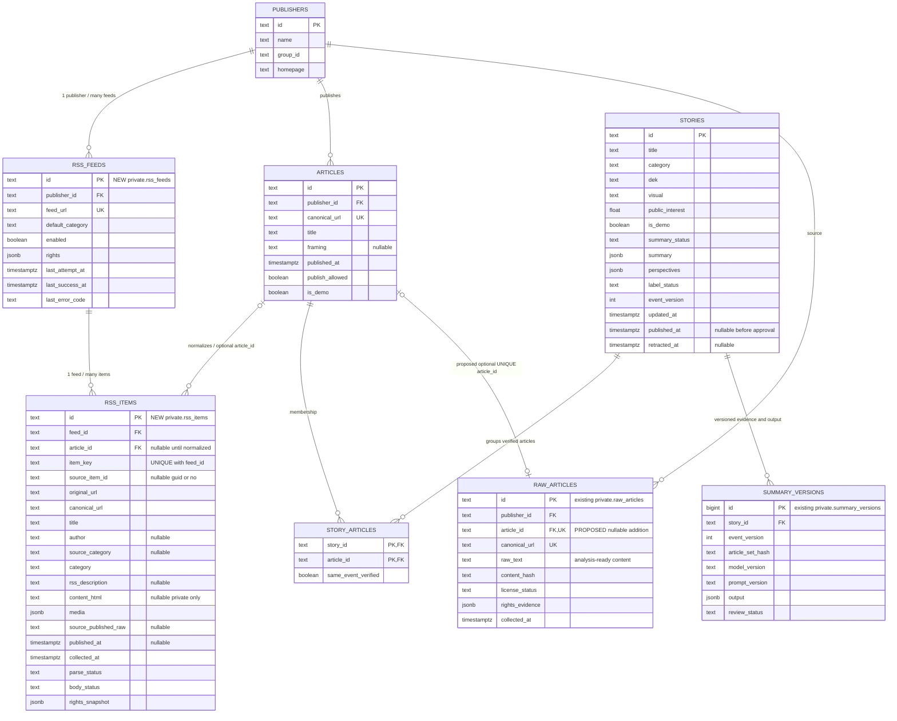
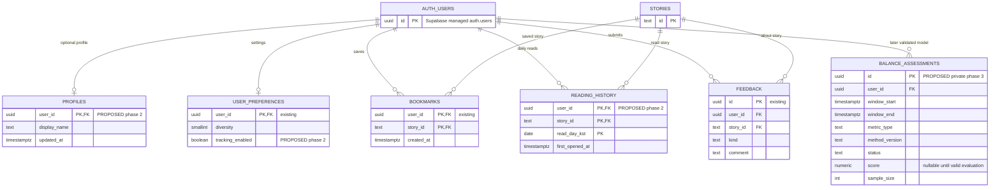

# 뉴스 서비스 ERD v1 — 현행 DB + RSS 확장안

기준일: 2026-10-22. **이 문서는 설계 기준안이며 Supabase에 적용한 migration이 아닙니다.**

## 1. 이번에는 실제 Supabase를 확인했습니다

프로젝트 `zcatmzjreiaovltposmm` / `filter-bubble-dev`에 인증된 브라우저로 접근하여 Schema Visualizer와 Database Tables를 읽었습니다. MCP의 프로젝트 조회 권한은 여전히 거부됐지만 브라우저 확인은 성공했습니다.

| 스키마 | 실제 확인한 테이블 | 화면의 추정 행 수 |
| --- | --- | --- |
| public | publishers / stories / articles / story_articles | 3 / 1 / 3 / 3 |
| public | bookmarks / user_preferences / feedback | 각 0 |
| private | raw_articles / pipeline_jobs / summary_versions | 각 0 |

행 수는 UI의 **ROWS (ESTIMATED)** 표시입니다. COUNT(*)로 재검증하지 않았습니다. RLS 정책·권한·데이터 내용 전체·API 동작을 이번 확인으로 검증한 것은 아닙니다. 스키마를 읽었을 뿐 SQL 실행이나 DB 변경은 하지 않았습니다.

- 근거: `2026-10-22-supabase-observed.json`, `2026-10-22-supabase-table-counts.txt`, `2026-10-22-supabase-private-observation.txt`.
- public/private 범위에는 RSS 피드/수신 항목 테이블이 없었습니다.
- 대시보드는 migration 등록 내역을 없다고 표시했습니다. SQL로 테이블을 만든 적이 없다는 의미는 아닙니다. 다음 변경부터 적용 이력을 남겨야 합니다.
- GitHub 작업 브랜치 최신 커밋은 `c2777d0a8cf1b02b8ae3dda12579c6017a771a49`로 바뀌었습니다. 공통 내부 오류 JSON·요청 ID 처리와 테스트가 추가된 코드를 확인했습니다. 이 테스트를 이번에 실행한 것은 아닙니다. 목록 쿼리 거부는 남아 있으며 CORS 코드는 해당 변경에 추가되지 않았습니다. 과거 22cd6e8 기준 오류 응답 관측은 현재 커밋의 재현 결과로 사용하지 않습니다.

## 2. 서비스에서 각 단위의 의미

- **언론사 publishers**: 기사를 발행한 곳. 소유 그룹(group_id)도 출처 독립성 판단의 자료가 됩니다.
- **피드 rss_feeds**: 언론사별 경제·정치 등 RSS 주소. 언론사 1개에 피드 여러 개가 연결됩니다.
- **수신 항목 rss_items**: RSS에서 받은 항목. 본문/날짜가 없어도 상태와 원본 정보를 보존합니다.
- **기사 articles**: URL 중복을 정리한 언론사별 기사 메타데이터. 수신과 공개 여부를 구분합니다.
- **사건 stories**: 같은 사건을 다룬 기사들을 묶는 서비스 단위. 뉴스 카드 하나에 해당합니다.
- **사건-기사 story_articles**: 어떤 기사가 어떤 사건에 속하는지와 동일 사건 검증 여부를 연결합니다.
- **본문 raw_articles**: 이용 범위와 충분성이 확인된 분석 입력. RSS 수신 항목을 억지로 여기에 넣지 않습니다.
- **요약 버전 summary_versions**: 특정 기사 묶음·모델·프롬프트로 만든 결과 및 검토 이력. 현재 stories.summary/perspectives는 API 호환을 위한 표시 결과입니다.

## 3. 핵심 ERD

**기존 유지:** publishers, articles, stories, story_articles, raw_articles, summary_versions.
**이번 추가 제안:** private.rss_feeds, private.rss_items.
**선택적 후속 보완:** raw_articles.article_id FK/UNIQUE. 현행 DB에는 이 컬럼이 없습니다.

`rss_items.article_id`는 정규화 전에는 null입니다. 같은 기사 URL이 두 피드에 나오면 rss_items는 유입 경로별로 존재하고 articles는 한 건으로 연결합니다. RSS 수신 건수와 고유 기사 건수는 다를 수 있습니다.

`pipeline_jobs`는 이미 존재합니다. 현재 payload JSON을 사용하는 작업 이력/재시도 테이블로, 화면에서 확인한 구조에는 feed/story로 향하는 명시적 FK가 없습니다. 그림에 임의의 FK를 추가하지 않았습니다.

## 4. 지금 만들 스키마의 최소 기준

| 영역 | 기준 |
| --- | --- |
| 기존 ID | 현재 text ID를 유지합니다. 기존 사건/기사 ID를 UUID로 일괄 변경하지 않습니다. |
| 피드 | `feed_url` UNIQUE, `publisher_id` FK. 단계별 권한·상태를 JSONB로 보존할 수 있습니다. |
| 수신 항목 | `(feed_id,item_key)` UNIQUE. source_item_id는 nullable이며 이것만으로 중복 방지를 해결하지 않습니다. |
| 다중 피드 중복 | items 여러 개가 articles 한 개를 참조합니다. articles.canonical_url UNIQUE를 유지합니다. |
| 본문 없는 RSS | description/content_html/published_at 등은 intake에서 nullable. 분석 준비된 raw_text 조건과 분리합니다. |
| 날짜 | 원본 문자열과 파싱 상태, 수집 시각을 별도 보존합니다. 누락된 발행일을 현재 시각으로 대체하지 않습니다. |
| 공개 기사 날짜 | 현재 공개 API의 article.published_at은 필수입니다. 날짜 미확인 intake를 공개 API에 그대로 반환하지 않습니다. |
| 기사 0개 사건 | 현재 API의 coverage에는 최소 기사/출처 1개 제약이 있습니다. 공개 근거가 전부 제외되면 그대로 0개 사건을 반환하지 말고 보류/제외 정책을 적용합니다. |
| 분류/상태 | category는 politics/economy/society/technology. 파싱·본문·권한·군집·요약 상태를 서로 다른 의미로 관리합니다. |
| 조회 성능 | rss_feeds.publisher_id, rss_items.article_id, story_articles.article_id 등 FK 조회 인덱스를 검토합니다. UNIQUE(feed_id,item_key)는 feed_id 선두 조회를 이미 지원합니다. |
| 데이터 공개 | 비공개 intake/원문은 API 노출에서 제외. public 테이블의 기존 RLS/공개 조건을 유지합니다. DB 고권한 연결은 조회 SQL에서도 공개 조건을 지켜야 합니다. |

인용 article_ids는 요약 출력 JSON 내부의 값이므로 일반 FK로 검증되지 않습니다. 요약 게시 전 인용이 공개 기사 집합에 속하는지 애플리케이션에서 검증해야 합니다. 사건의 기사 구성이 달라지면 event_version/article_set_hash를 통해 이전 요약의 재검토 여부를 판단합니다.

상세 테이블은 `news-service-erd-v1.mmd`에 필드와 함께 있습니다. 그 파일도 실제 migration이 아닙니다.

## 5. 마이페이지 확장 ERD — 지금 전부 만들 필요는 없습니다

현재 bookmarks/user_preferences/feedback은 존재합니다. profiles/reading_history/balance_assessments와 tracking_enabled는 후속 제안입니다. 현재 프론트의 로컬 저장을 당장 서버 저장으로 바꾸라는 의미가 아닙니다.

- 사용자 ID는 Supabase `auth.users.id`를 참조합니다. 비밀번호를 별도 프로필 테이블에 저장하지 않습니다.
- reading_history는 `(user_id,story_id,read_day_kst)`로 한국 시간 하루 1회 열람을 집계하는 제안입니다. 상세를 연 기록이며 완독 측정은 아닙니다.
- 카테고리 분포/날짜별 독서량은 열람 기록에서 계산할 수 있어 처음부터 별도 통계 테이블을 만들 필요가 없습니다.
- 균형 평가 테이블은 검증된 지표·산식·충분한 표본이 준비된 이후 단계입니다. 점수가 없으면 null/대기 상태로 두고, 주제 다양성을 정치적 중립성으로 단정하지 않습니다.
- 사용자 테이블은 본인 행만 접근하는 정책을 설계해야 합니다. 표에 있다는 이유로 인증·API·RLS가 구현됐다고 취급하지 않습니다.

## 6. 적용 순서

1. 이 ERD와 내부 RSS JSON v1을 작업 기준으로 사용합니다. 각자 샘플로 개발을 즉시 시작합니다.
2. 팀원은 현재 실제 테이블과 비교한 추가 migration을 작성합니다. 기존 테이블 삭제/재생성은 필요하지 않습니다.
3. 팀원은 개발 DB에 피드·수신 테이블과 필요한 FK/인덱스/권한을 추가하고 적용 이력을 남깁니다.
4. 본인은 API 기본 요청·CORS·표시 로직을 개발합니다. DB 내부 필드를 화면 API 전체에 노출하지 않습니다.
5. 마지막 통합 시 실제 RSS 수집 결과를 읽어 샘플 대신 연결하고, 기존 가상 사건 1개/기사 3개가 유지되는지도 확인합니다.

이 문서에서 ‘추가’한 구조는 Supabase에 적용하지 않았습니다. 실제 migration 실행·롤백·권한 검증은 DB 담당자의 작업입니다.
